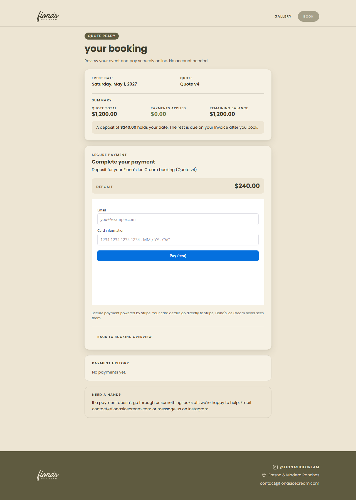

# Customer booking & payments

Customers pay Quote deposits and Invoice balances through Stripe Checkout from one stable,
inquiry-scoped page: `/pay/{publicId}` on the public site. Checkout is either **hosted** (the tab
goes to Stripe and comes back) or **embedded** (Stripe's own form is mounted inside this page;
see [Embedded Checkout](#embedded-checkout)); commerce picks the mode per attempt. Staff issue and
manage that link from the request workspace. The backend contract is fionas-commerce PR #36
(merged) plus PR #38 (presentation modes); its `docs/stripe-payments-frontend-handoff.md`,
`docs/stripe-payments-operations.md` and executable OpenAPI are authoritative and are deliberately
not copied here.

**The frontend presents and initiates payments; it never decides that money was received.**
Commerce owns access, terms, amounts, authorizations and reconciliation; the ledger owns money.

## Where code lives

| Concern                                          | File                                                                                   |
| ------------------------------------------------ | -------------------------------------------------------------------------------------- |
| Customer page                                    | `apps/public/src/routes/pay/[publicId=uuid]/`                                          |
| Page state machine (refresh, checkout, recovery) | `apps/public/src/lib/payments/controller.ts`                                           |
| Fail-closed view of the summary                  | `apps/public/src/lib/payments/view.ts`                                                 |
| Contract types and strict readers                | `apps/public/src/lib/payments/contract.ts`                                             |
| Exact USD cents (BigInt)                         | `apps/public/src/lib/payments/money.ts`                                                |
| Bearer capture, tab storage, error classes       | `apps/public/src/lib/payments/checkout.ts`                                             |
| Stripe.js boundary (load, mount, teardown)       | `apps/public/src/lib/payments/embedded.ts`                                             |
| Embedded payment panel                           | `apps/public/src/lib/components/payments/embedded-checkout.svelte`                     |
| Customer wording                                 | `apps/public/src/lib/payments/copy.ts`, `$lib/components/payments/`                    |
| Public payment BFF (the only commerce access)    | `apps/public/src/lib/server/payments/bff.server.ts`, `transport.server.ts`             |
| BFF routes                                       | `apps/public/src/routes/api/payments/[publicId=uuid]/`                                 |
| Security headers                                 | `apps/public/src/hooks.server.ts`                                                      |
| Staff link and attempt client, form action       | `apps/admin/src/lib/server/customer-payments.ts`, `$lib/customer-payments.ts`          |
| Staff Customer payments card                     | `apps/admin/src/lib/components/requests/customer-payments.svelte`                      |
| Staff diagnostics refresh endpoint               | `apps/admin/src/routes/(app)/requests/[inquiryId]/customer-payments/+server.ts`        |
| E2E stubs                                        | `apps/public/e2e/payments/stub-commerce.mjs`, `apps/admin/e2e/payment-access-stub.mjs` |

## The stable URL and bearer lifecycle

```
https://www.fionasicecream.com/pay/b8251ea0-c07c-4aad-bceb-644ed075c0a1#<43-character bearer>
                                    └ nonsecret publicId (path) ┘        └ secret (fragment) ┘
```

The fragment never reaches any server (not ours, not a CDN, not a log), so the page's server render
contains no booking data at all; the load function is empty. On the browser:

1. Read `location.hash`. It must be exactly 43 base64url characters; anything else shows
   "This payment link looks incomplete" and is never sent.
2. Store the bearer in **this tab's sessionStorage**, keyed by publicId
   (`fionas.pay.{publicId}.token`). A newer fragment replaces an older one (a rotated link).
3. Remove the fragment immediately with `history.replaceState` (SvelteKit's history state is kept;
   its `page.url` is synced right after hydration). Any `?checkout=` return marker goes too.
4. Read the summary through the same-origin BFF.

With no fragment, the page uses the bearer saved in this tab (this is how a Stripe return works).
With neither, it shows **Payment link required** and asks the customer to reopen the original link.
A 404 (unknown, rotated or revoked bearer; commerce answers all three identically) forgets the
bearer and shows "This payment link is no longer active". There is no lookup by email or name and
no credential recovery endpoint.

The bearer is never put in localStorage, cookies, query strings, server data, analytics, logs or a
global store: it lives in the page controller's closure and this tab's sessionStorage. If
sessionStorage is blocked the page still works while it stays open, and says so. A copied link
works in a new tab because it carries the fragment; a Stripe return relies on the original tab.

Opening a different link in the same tab (only the fragment changes) reloads the page from it.

## Same-origin BFF

The browser only calls the public site's own origin, with `credentials: 'omit'`:

| Browser call                                      | Forwarded to commerce                                                                  |
| ------------------------------------------------- | -------------------------------------------------------------------------------------- |
| `GET /api/payments/{publicId}`                    | `GET /public/payments/{publicId}` (`readCustomerPaymentSummary`)                       |
| `POST /api/payments/{publicId}/checkout-sessions` | `POST /public/payments/{publicId}/checkout-sessions` (`createCustomerCheckoutSession`) |

Exactly two narrow endpoints, not a proxy. Before any commerce call the BFF validates the UUID,
exactly one 43-character `X-Fionas-Payment-Token`, and (POST) a same-origin `Origin`,
`Sec-Fetch-Site` when present, `application/json`, an `Idempotency-Key` of 1–128
`[A-Za-z0-9_-]`, a body of at most 1 KiB, and a command of exactly `expectedDocumentVersion`,
`expectedBusinessRevision` and optional integer `amountMinor` (50–99,999,999). Anything else
(currency, totals, purpose, terms, proposal ids) is refused. The command is re-serialized
canonically.

Commerce receives only `Accept`, the bearer, and for checkout `Content-Type` and
`Idempotency-Key`: never site cookies, a staff session, a SERVICE token or any other browser
header. Redirects are not followed. Responses are re-built from the documented customer-safe
fields (unknown fields are dropped) and validated; error bodies keep only the stable `code` plus a
known conflict message (`PAYMENT_TERMS_CHANGED`, `CHECKOUT_KEY_REUSED`, `RECONCILIATION_PENDING`).
Backend message text never reaches the customer.

| Commerce outcome                       | BFF answer                 | Customer meaning            |
| -------------------------------------- | -------------------------- | --------------------------- |
| 200 valid                              | 200 (whitelisted)          | render / redirect           |
| 200 malformed                          | 502 `invalid_response`     | unknown outcome             |
| 400 / 404 / 409 / 422                  | same status, stable code   | per the table below         |
| 503 `stripe_disabled`                  | 503 `stripe_disabled`      | online payments unavailable |
| `COMMERCE_API_URL` unset or invalid    | 503 `payments_unavailable` | online payments unavailable |
| other 5xx, redirect, unexpected status | 502 `internal_failure`     | unknown outcome (same key)  |
| timeout / connection failure           | 504 `unavailable`          | unknown outcome (same key)  |

`transport.server.ts` is the only reader of `COMMERCE_API_URL` and logs only an operation name, a
status and a failure kind: never the URL, bearer, key, body or publicId. When commerce answers
200 but the body fails validation, `bff.server.ts` logs `Commerce payments answered with an
unreadable body` with the operation and the fixed name of the failed check (`ui_mode`,
`client_secret`, `credentials`, `summary`, …); an unexpected non-5xx status is logged as
`answered with an unexpected status`. Neither ever includes a value from the body. It never imports NATS or
inquiry submission code (`server-boundary.test.ts` enforces both).

**Headers.** Every `/pay/*` response (including `__data.json` and error pages) and every
`/api/payments/*` response sends `Cache-Control: no-store`, `Referrer-Policy: no-referrer`,
`X-Robots-Tag: noindex, nofollow`, `X-Content-Type-Options: nosniff` and

```
Content-Security-Policy: frame-ancestors 'none'; frame-src https://js.stripe.com https://*.js.stripe.com https://checkout.stripe.com https://hooks.stripe.com
```

(`PAYMENT_CSP` in `bff.server.ts`). `frame-ancestors 'none'` stops other sites framing this page;
it doesn't limit what the page frames. `frame-src` then allows only Stripe's documented frame
origins: Embedded Checkout and Stripe.js frames, hosted Checkout, and 3D Secure / redirect
authentication. The site has no `script-src` or `connect-src` policy today, so Stripe.js (fetched
only from `https://js.stripe.com`) and its calls to Stripe aren't otherwise restricted. Anyone
adding one site-wide (or at the CDN/host) must allow at least `script-src https://js.stripe.com
https://*.js.stripe.com`, `connect-src https://api.stripe.com https://checkout.stripe.com` and
`img-src https://*.stripe.com` on `/pay`, plus SvelteKit's own inline bootstrap (nonce or hash).
Railway and the Cloudflare proxy add no CSP today. The page also has robots and referrer meta tags
and turns off SvelteKit link preloading. The only third-party script that may run here is official
Stripe.js, and only after commerce opens an embedded attempt; no analytics or service worker.

**No JavaScript.** Authorization arrives in the fragment, so the flow needs JavaScript. Without it
the page shows a branded explanation with the contact email; secrets never move to query strings.

## Page states

`paymentView(summary)` derives what the customer can do; anything unknown fails closed:

| Summary                                                            | View             | Action                                  |
| ------------------------------------------------------------------ | ---------------- | --------------------------------------- |
| QUOTED, DEPOSIT, QUOTE, canPay                                     | `deposit-due`    | Pay the exact deposit (no amount input) |
| BOOKED/SERVED, INVOICE, INVOICE, canPay                            | `balance-due`    | Pay the balance, or a different amount  |
| `paymentInProgress`                                                | `in-progress`    | Wait (polled); optional recovery check  |
| `reconciliationPending`                                            | `reconciliation` | Contact staff; no collection            |
| `NO_PAYMENT_DUE`                                                   | `no-balance`     | Paid up, or a credit                    |
| `CLOSED`                                                           | `closed`         | Read-only history                       |
| `BELOW_STRIPE_MINIMUM` / deposit `ABOVE_STRIPE_MAXIMUM`            | `staff-assist`   | Contact staff                           |
| `NOT_PUBLISHED`                                                    | `not-ready`      | Wait for the quote                      |
| `UNSUPPORTED_CURRENCY`, unknown reason/lifecycle/mode, incoherence | `unavailable`    | Contact staff                           |

Page phases around it: initializing, link required, link incomplete, link unavailable, backend
unreachable (with Try again) and online payments unavailable. Busy states (`submitting`,
`redirecting`) disable the action. The document is labelled **Quote** or **Invoice** only:
customers never see generated version labels (no "Quote v4", "Invoice v8" or "Booked from Quote
v4"), in the overview, the payment copy or the Embedded Checkout description. `document.version`
and `businessRevision` stay internal and are still sent back exactly as `expectedDocumentVersion`
and `expectedBusinessRevision`; `acceptedQuoteRevision` is still validated but not shown. Hiding a
label never relaxes stale-term rejection. Figures come straight from the summary: total, payments
applied, remaining balance (or credit), the deposit while QUOTED, a whole-percent progress bar
after booking (presentation only), and receipts with refunded amounts. No line items, taxes,
service details, names, receipts or PDFs are invented.

**Privacy boundary.** A payment link is a bearer capability anyone holding it can open, including
from a forwarded financial email. The page shows only the event date, the document kind, totals,
payment progress and receipt amounts/dates. `readPaymentSummary` whitelists those fields, so the
page cannot render customer names, email addresses, phone numbers, postal addresses, staff notes,
conversation text, service descriptions or administration capabilities even if a response carried
them (covered by `contract.test.ts`). Bearer-only access, fragment handling, no-store, no-referrer
and noindex are unchanged.

**Exact money.** Decimal strings become BigInt cents (`decimalToCents`); a value that isn't whole
cents makes the summary invalid rather than rounded. Partial input accepts `250`, `250.5`,
`$1,250.00`, refuses more than two decimals, and must be at least $0.50, at most $999,999.99 and
at most the balance. A balance above the Stripe maximum disables the full option and requires a
partial; a balance below the minimum asks for staff help.

## Checkout idempotency

A deliberate Pay click freezes the reviewed `document.version`, `businessRevision` and amount,
generates one `crypto.randomUUID()` key, and **saves the key and exact body in sessionStorage
before sending** (`fionas.pay.{publicId}.checkout`). Double clicks are ignored in the controller
(not only by disabling the button), and while a saved command exists the ordinary Pay is hidden.

| Result                                                           | Handling                                                                          |
| ---------------------------------------------------------------- | --------------------------------------------------------------------------------- |
| 200 OPEN HOSTED with a `https://checkout.stripe.com` URL         | mark the command redirected, navigate this tab (URL never stored)                 |
| 200 OPEN EMBEDDED with a client secret                           | mark the command redirected, mount Stripe's form here (secret in memory only)     |
| 200 OPEN HOSTED with a URL off the allowlist                     | refresh; the summary decides (OPEN → "earlier checkout still open")               |
| 200 unknown `uiMode`, both or neither credential (malformed)     | unknown outcome: keep the command, offer only **Try again** with the same key     |
| 200 EXPIRED / FAILED                                             | historical replay: forget the command, ask for a new deliberate payment           |
| network failure, timeout, 5xx                                    | retry the **same key and bytes** after 1.5 s and 4 s, then "Try again" (same key) |
| 409 `PAYMENT_TERMS_CHANGED`                                      | forget the key, refresh, "Your booking was updated"; next click is a new key      |
| 409 `CHECKOUT_KEY_REUSED`                                        | keep and block the command; only a deliberate **Start over** discards it          |
| 409 recovery codes (below)                                       | no key was claimed: forget it, refresh, explain; never an automatic retry         |
| 409 `RECONCILIATION_PENDING`, `checkout_reconciliation_required` | contact staff                                                                     |
| 422 / 400                                                        | forget the key, explain; the customer may try deliberately                        |
| 404                                                              | link no longer active                                                             |
| 503 `stripe_disabled`                                            | online payments unavailable                                                       |
| any other code                                                   | fail closed: refresh and require review                                           |

An ambiguous outcome survives a reload of the tab: the saved command stays `sending`, so the page
offers only **Try again** with the identical command. Payment is never re-authorized because a
request timed out.

## Freshness and uncertain outcomes

**Fresh summaries only.** `summaryFresh` separates a summary kept on screen for reading from one
that may back a new financial decision. It is true only after the latest read succeeded; a failed
refresh keeps the figures visible but disables Pay and fresh-key recovery behind **We couldn't
confirm your current balance, so paying is paused** with **Check again**. A summary older than five
minutes (`MAX_SUMMARY_AGE_MS`) is re-read when the customer clicks Pay: unchanged terms proceed in
the same click; changed terms (document version, business revision, purpose or amount) stop with
**Your booking was updated** for review; a failed re-read pauses paying. Resending this tab's own
saved command (Try again, resuming a cancelled Checkout) needs no fresh summary: the same key can
only reach its original authorization.

**Ordered reads.** Summary reads (start, manual refresh, polling, visibility, after a checkout
response, the pre-payment re-read) can overlap, so each takes a monotonically increasing
generation and only the latest may change anything: summary, freshness, notices, pending command
state, polling, loading, link revocation and the disabled state alike. A superseded read, whether
it succeeded, failed, got a 404 or `stripe_disabled`, is discarded untouched and reports
`superseded`. The pre-payment re-read follows superseding reads to the latest outcome, and proceeds
only when that read was accepted, nothing newer is pending and the terms still match; Pay is also
disabled while any read is in flight. Same-key resends never depend on these reads.

**Never a false guarantee.** `paymentUncertain` is true while this tab holds a saved command
(`sending` or `redirected`), after a Stripe return until a summary has resolved it, or when a
revoked link dropped one. Unavailability then reads **We can't confirm your payment status right
now. Please don't make another payment until we've checked it. Contact Fiona's if you need
assistance.**, for an unreachable backend, disabled payments and a failed refresh alike, and a
revoked link asks the customer to contact Fiona's before paying again. Without a possible payment,
disabled payments read "Online payments aren't available right now. Please try again later or
contact us for help." No message says a customer was or wasn't charged unless a summary shows it:
success wording needs the summary's effect, and a cancel redirect, an outage or a configuration
failure proves nothing. A `stripe_disabled` answer keeps a saved command unless it was brand new
and refused on its first attempt, because that refusal says nothing about an earlier send.

## Returning from Stripe

Commerce sends customers to `/pay/{publicId}?checkout=returned` or `?checkout=cancelled`. Neither
proves anything. The page restores the bearer, removes the marker and reads the summary:

- still `paymentInProgress` → **Confirming your payment** (returned) or **Checkout was cancelled**
  (cancelled; the Session may still be open) and polling;
- `QUOTED` → `BOOKED`/`SERVED`/`CLOSED` after a deposit → **Deposit received. Your booking is
  confirmed.** with the authoritative remaining balance;
- `paidAmount` increased after an Invoice payment → **Payment received. Your remaining balance is $X.**;
- otherwise → "Your last checkout wasn't completed".

A cancelled Checkout is never replaced just because the customer came back. Polling runs only
while a payment is underway and the page is visible, with bounded backoff (2, 3, 5, 8, 13, 20,
30, 30 s, then four 60 s reads, about six minutes), then offers **Check again**. There is no
public SSE.

## Embedded Checkout

Embedded Checkout changes where the customer types card details, not who authorizes a payment,
records money or decides that a booking is paid. Stripe renders every card field, wallet and
authentication step inside its own iframe; Fiona's page never has a card input.



**Two response modes.** Each checkout answer names its own immutable `uiMode`, so the page never
assumes how commerce is currently configured. `readCheckoutResponse` / `checkoutLaunch` in
`contract.ts`:

| OPEN answer                                                 | Read as                                        |
| ----------------------------------------------------------- | ---------------------------------------------- |
| `uiMode: HOSTED` + allowlisted `url`, no `clientSecret`     | navigate this tab (as before)                  |
| `uiMode: EMBEDDED` + `clientSecret` (any well-formed token) | mount Stripe's form on this page               |
| no `uiMode` + `url`, no `clientSecret` (pre-PR #38 release) | HOSTED, for the deploy overlap only            |
| unknown mode, both credentials, the wrong one, or neither   | refused (unknown outcome, same-key Try again)  |
| PROCESSING / SUCCEEDED / EXPIRED / FAILED                   | state and outcome kept; any credential dropped |

EMBEDDED is never inferred. The BFF re-serializes the same reader's output, so the client secret
reaches the browser only in the answer to its own authorized checkout POST; summaries, page loads,
errors and logs never carry it.

**Starting.** A deliberate Pay click works exactly as before (fresh summary, reviewed terms, one
saved key and body). On an EMBEDDED answer the tab stays on `/pay/{publicId}`: the action card is
replaced by **Complete your payment** with the authorized amount and Quote/Invoice revision (from
the saved command, never a newer summary), Stripe's form, and **Back to booking overview**. Focus
moves to the panel heading. Stripe.js is requested from `js.stripe.com` only then (`@stripe/stripe-js/pure`
in a lazily imported chunk), never at page load or during SSR.

**Client-secret lifecycle.** The controller keeps the secret in its closure and exposes the launch
as `{ id, attemptId, purpose, amountCents, businessRevision, clientSecret() }`. `clientSecret()`
resolves only while that launch is current and rejects once the form is closed, completed,
replaced, revoked or the page is disposed, so it serves Stripe's `fetchClientSecret` and nothing
else. It is never written to sessionStorage, localStorage, cookies, URLs, history, server data,
logs or state that could be serialized. A secret needed again is obtained only by resending the
original key and exact body.

**Saved command.** The sessionStorage command keeps its `phase` literal `redirected` (meaning
"commerce opened a provider Session", whether or not the tab navigated) so commands survive a
deploy in either direction, and gains two optional nonsecret fields: `uiMode` and `completing`.
Commands saved by the previous release (no `uiMode`) read exactly as before.

**One authorization.** While the form is open, Pay, recovery and Try again are no-ops in the
controller; a remount, summary refresh or Stripe.js callback never sends a command. The Svelte
component (`embedded-checkout.svelte`, keyed by launch) and `embedded.ts` mount one Stripe
instance per launch, serialize teardown before any new instance (Stripe allows one per page),
destroy an initialization that resolves after cleanup unmounted, and ignore late callbacks.

**Completion.** Stripe's `onComplete` (commerce sets `redirect_on_completion=if_required`) never
marks anything paid. The controller removes the form, marks the saved command `completing`, keeps
new payments closed, shows **Confirming your payment** / "We're confirming your payment", and
restarts the bounded summary polling. Only commerce's summary confirms: QUOTED → BOOKED shows
**Deposit received. Your booking is confirmed.** with the new Invoice and balance; a higher
`paidAmount` shows **Payment received. Your remaining balance is $X.** and a new deliberate Pay
for any further amount (a new key). A final payment shows **Your booking is paid in full.** with
no action; the booking never becomes CLOSED here.

**Closing the form.** **Back to booking overview** discards the secret and unmounts Stripe. It
does not cancel or expire the Session and proves nothing about money, so the page says **Your
payment is still open** and offers **Continue your payment**, which resends the same key and body
to reach the same Session.

**Reloads and returns.** A reload loses the secret by design. With the saved command still open
the page shows the same notice and **Continue your payment** (same key; nothing is sent on its
own). A Stripe authentication redirect returns to `?checkout=returned`, which is handled like any
return: restore the bearer, clean the URL, read the summary, then confirm or keep waiting. After
`onComplete`, a reload shows confirming rather than offering the form again.

**Failures.** A missing or malformed `PUBLIC_STRIPE_PUBLISHABLE_KEY` shows "Online card entry
isn't available on this page right now" with the contact email. A Stripe.js load or mount failure
(network, blocker, CSP) shows "We couldn't load the secure payment form" with **Try again**, which
remounts the same launch. Neither touches the saved command or creates a new authorization;
Stripe's error text is never logged or shown.

**Mode switches.** An attempt keeps its mode for its lifetime: a hosted attempt still navigates
after commerce switches to embedded, and an embedded one still mounts after a switch back.

**Changed terms.** A mounted form stays tied to the authorization that created it. Commerce keeps
reporting `paymentInProgress` while the original Session is open, even after staff amend the
booking, so "still underway" isn't enough. Every accepted (latest-generation) summary is compared
with the saved command by `authorizationMatches` (`controller.ts`):

| Saved command | Still valid only while the summary shows                                                             |
| ------------- | ---------------------------------------------------------------------------------------------------- |
| both          | the same `document.version` and `businessRevision`, USD                                              |
| DEPOSIT       | QUOTED, mode DEPOSIT, stage QUOTE, `requiredAmount` exactly the authorized cents                     |
| INVOICE       | BOOKED or SERVED, mode INVOICE, stage INVOICE, `balance` (applied money only) ≥ the authorized cents |

So an Invoice amendment, a deposit change, a manual payment that leaves less than the authorized
amount, a paid-in-full or CLOSED booking, or a DEPOSIT → INVOICE change all remove the form, even
while the attempt stays underway. A change commerce doesn't publish (such as an internal
deposit-requirement revision with the same amount) isn't visible here; commerce's own checks and
reconciliation remain the final safeguard, and a payment already submitted in that race is
reconciled there.

On a mismatch the controller drops the secret (its capability rejects, so a pending Stripe.js
initialization gets nothing and a late `onComplete` for that launch is ignored), the component
destroys the iframe, and the saved command, key, body, amount and revisions stay untouched. The
page shows **Your booking's payment details have changed** (derived again on every summary, so it
stays while the attempt is unresolved and survives reloads) and offers only **Check previous
payment**. That resends the original key and body so commerce can inspect the Session. If commerce
answers with the same OPEN embedded Session, its secret is discarded unmounted; EXPIRED/FAILED,
`PAYMENT_TERMS_CHANGED`, recovery and reconciliation answers follow the usual rules. A new payment
is possible only after the old attempt is resolved, as a fresh reviewed decision with a new key.

| Situation                                    | Page shows                                                      |
| -------------------------------------------- | --------------------------------------------------------------- |
| Customer closed the form, terms unchanged    | Your payment is still open → **Continue your payment**          |
| Accepted summary shows changed terms         | payment details have changed → **Check previous payment**       |
| Stripe completed, commerce hasn't reconciled | Confirming your payment (no action)                             |
| No answer to the checkout request            | the existing unknown-outcome wording → **Try again** (same key) |

If a summary shows the attempt no longer underway (settled, expired, reconciliation) the form is
removed and the authoritative state shown; a revoked link or disabled payments remove it too. It is
never replaced automatically. Failed, 5xx or superseded reads change nothing, so a valid form stays
mounted (Stripe doesn't depend on them), and only the newest accepted summary decides.

**Appearance.** Stripe's form uses the Stripe account's Checkout branding. Set it in the Stripe
Dashboard to match the page (background `--cream-100` `#f6f1e4`, button/accent `--olive-700`
`#5f5b40`) for each account and mode; fionas-web can't style the iframe.

## Recovery and reconciliation

While a payment is underway the ordinary Pay is disabled. When the summary's optional
`checkoutRecoveryAvailable` is true (absent means false), or this tab still holds its own
redirected command, the page offers a separate **Check previous payment and continue**:

- with this tab's original key and body: resend them, which returns the original authorization
  (back to the same open Checkout) or a historical result;
- without them (another browser, lost storage): one deliberate command with a fresh key and the
  currently reviewed versions (and, for an Invoice, the chosen amount). Commerce checks the old
  Session first and authorizes a replacement only after confirmed expiry/failure.

| Recovery code                      | Customer sees                                                    |
| ---------------------------------- | ---------------------------------------------------------------- |
| `checkout_in_progress`             | An earlier checkout is still open (expires within about an hour) |
| `payment_processing`               | A payment is being confirmed; don't start another                |
| `payment_state_changed`            | An earlier payment was recorded; review the new balance          |
| `checkout_recovery_conflict`       | Status just changed; review and retry deliberately               |
| `checkout_reconciliation_required` | A payment needs staff review; contact us                         |

None of these claims a key or starts a retry loop. `reconciliationPending` shows "We received a
payment that needs staff review. Please contact Fiona's before paying again." and offers no payment
until commerce clears it. BOOKED is shown only when commerce says BOOKED.

## Staff link management

The request workspace's **Customer payments** card sits directly under **Right now** (both in the
rail on wide layouts; before Activity when stacked). It renders only for QUOTED, BOOKED, SERVED
and CLOSED and only when the staff member has **all three** of `fionas.payment-access.manage`,
`fionas.inquiries.read` and `commerce.financial-document.read`; otherwise no backend call is made
and every other workspace capability is unchanged. The first permission is granted to no role,
Administrators included: an administrator must grant it explicitly through runtime role
administration. The console never expands grants or substitutes a SERVICE credential.

| Staff action                  | Commerce call                                                       |
| ----------------------------- | ------------------------------------------------------------------- |
| workspace load (status only)  | `GET /staff/requests/{id}/payment-access`, `GET …/payment-attempts` |
| Create / issue a new link     | `POST /staff/requests/{id}/payment-access`                          |
| Copy payment link             | `GET /staff/requests/{id}/payment-access` (deliberate, read-only)   |
| Rotate link (confirmed)       | `POST /staff/requests/{id}/payment-access/rotate`                   |
| Revoke link (confirmed)       | `POST /staff/requests/{id}/payment-access/revoke`                   |
| Check with Stripe (confirmed) | `POST /staff/requests/{id}/payment-attempts/{attemptId}/reconcile`  |

All go through `backend.ts` with the staff member's own cookie and trusted `Origin`; POSTs have no
body and are sent once (never retried; an uncertain result says **Reload to review** and blocks
the card). The workspace load exposes only `none` / `active` / `revoked` and the nonsecret
publicId: the usable URL is read only when staff click **Copy payment link**, returned only in that
action's response, validated to be exactly `…/pay/{publicId}#<43 chars>`, and written to the
clipboard (`ClipboardItem` inside the click's activation, then `writeText`). If the clipboard is
unavailable, a selectable read-only field shows it until hidden or for two minutes. Copying never
rotates or recreates the link; the same link survives Quote revisions and Invoice amendments.

Rotation and revocation each sit behind a disclosure that explains the consequence (every copy
stops working; payments already underway can still be reconciled) before the confirming button.
CLOSED bookings can copy and revoke an existing link but cannot create or rotate one. REQUESTED and
DECLINED never show the card. Stripe disabled reads "Online payments are turned off in commerce";
manual payments still work.

With JavaScript, actions are enhanced forms whose results stay inside the card: no workspace
invalidation, so reply drafts, editor drafts and disclosures are untouched. Without JavaScript the
same `?/customerPayments` action re-renders the page.

**Attempt diagnostics** (a disclosure) list purpose, authorized amount, creation time (Pacific),
the reviewed Quote/Invoice revision, provider state, reconciliation outcome, whether a ledger
payment exists and the static diagnostic code. `RECONCILIATION_REQUIRED` is highlighted in rust
with "Money reached the ledger but was not allocated automatically" and a card-level warning; it is
never presented as applied. **Check with Stripe…** appears for active or paid-but-pending attempts,
explains that it never creates a charge or allocates unapplied money, and refreshes the list. Any
provider URL in the reconcile response is dropped. Attempts are diagnostics, not ledger facts:
Activity remains the payment history, and nothing here repeats it. No refund or dispute controls.

**Live updates.** The existing timeline SSE is unchanged. After each authoritative Activity read
(`onrefreshed` on the Conversation card), Customer payments refreshes its diagnostics through
`GET /requests/{id}/customer-payments` if the attempts disclosure is open, or marks them stale for
when it opens. When the Activity history changed, the workspace also re-reads the authoritative
staff request and refreshes Right now in place (an online deposit shows BOOKED, the Invoice and
the new balance without a reload); an open review panel keeps its snapshot and says it is stale.
See [Live staff financial state](admin-request-workspace.md#live-staff-financial-state). Nothing
invalidates the whole page.

## Configuration and deployment

| App    | Variable                        | Purpose                                                                                                                                                                                     |
| ------ | ------------------------------- | ------------------------------------------------------------------------------------------------------------------------------------------------------------------------------------------- |
| public | `COMMERCE_API_URL`              | Commerce origin for the payment BFF only (bare http(s) origin). Unset: payments unavailable                                                                                                 |
| public | `ORIGIN`                        | adapter-node's public origin; must match the browser's, or checkout POSTs are refused (403)                                                                                                 |
| public | `PUBLIC_STRIPE_PUBLISHABLE_KEY` | Stripe publishable key for Embedded Checkout (`pk_test_…` / `pk_live_…`), same account and mode as commerce. Runtime (restart, no rebuild). Unset: embedded attempts show a contact message |
| admin  | `COMMERCE_API_URL`              | Unchanged; the staff link endpoints use it                                                                                                                                                  |

The public app holds no Stripe secret or restricted key, webhook secret,
`FIONAS_PAYMENT_ACCESS_KEY`, staff credential or session; never configure them in fionas-web. The
publishable key is the only Stripe value here; it is public by design and is needed only once
commerce opens EMBEDDED attempts (hosted Checkout, the marketing site, `/book` and the admin
console never use it).

**Rollout order.** 1) Deploy commerce PR #38 with `FIONAS_STRIPE_CHECKOUT_MODE=hosted` (the
default). 2) Deploy this frontend with `PUBLIC_STRIPE_PUBLISHABLE_KEY` set; hosted payments are
unchanged. 3) Switch commerce to `embedded` and verify a new attempt (below). Rolling back to
`hosted` affects only new attempts; open embedded attempts still mount here, so keep the key set. In commerce, `FIONAS_PUBLIC_BASE_URL` must be this
public site's exact origin (the one serving `/pay/{publicId}`), so issued links and Stripe return
URLs point here.

**Local.** Run commerce on `http://localhost:8080` with `FIONAS_STRIPE_ENABLED=true`,
`FIONAS_STRIPE_LIVE_MODE=false`, a `sk_test_` key and `FIONAS_PUBLIC_BASE_URL=http://localhost:5173`
(test mode allows localhost). Set `COMMERCE_API_URL=http://localhost:8080` in `apps/public/.env`,
`npm run dev` and `npm run dev:admin`, grant your staff role `fionas.payment-access.manage`, then
issue and copy a link from a quoted request. The booking form (NATS) is independent: payments work
with `BOOKING_ENABLED=false` and no NATS.

**Staging / Railway.** On the public service add `COMMERCE_API_URL` pointing at commerce's private
network address (for example `http://fionas-commerce.railway.internal:8080`) or its HTTPS URL, and
keep `ORIGIN` at the public HTTPS origin. Set commerce's `FIONAS_PUBLIC_BASE_URL` to that origin
(for example `https://dev.fionasicecream.com`). Exclude `X-Fionas-Payment-Token`, URL fragments,
staff payment-access responses and Checkout URLs from any proxy/CDN/APM logging, and don't cache
`/pay/*` or `/api/payments/*` at the edge. Allow at least 40 s upstream timeouts on
`/api/payments/*/checkout-sessions` (commerce may contact Stripe and recover an earlier attempt).
If commerce is down or Stripe disabled, `/pay` says so and the marketing site and `/book` are
unaffected.

## Test-mode acceptance (manual)

Follow commerce's operations runbook for Stripe test mode and the webhook listener, then:

1. Grant a staff role `fionas.payment-access.manage`; confirm another account without it still
   sees the workspace and manual payments but no Customer payments card.
2. On a QUOTED request, **Create payment link**, then **Copy payment link**; copy again and confirm
   the same URL.
3. Open it in a fresh window: the fragment disappears, "Quote" (no version) and the exact deposit
   show.
4. Pay the deposit with test card `4242 4242 4242 4242`; on return the page shows confirming,
   then **Deposit received. Your booking is confirmed.**, Booked, "Invoice" and the balance.
5. Amend the Invoice in the console; reload the same link: the new Invoice revision and balance.
6. Pay a partial amount, then the rest; the page reports each applied payment and the balance.
7. Start a checkout and press Back on Stripe: **Checkout was cancelled**; **Check previous payment
   and continue** returns to the same Session.
8. Rotate the link: the old copy shows "no longer active"; the new copy works. Revoke: both fail.
9. Inspect **Online payment attempts** for the attempts above; use **Check with Stripe** on an open
   one.
10. Close the request after settlement: the link shows read-only history; the card offers only
    copy and revoke.

**Embedded mode** (after switching commerce to `FIONAS_STRIPE_CHECKOUT_MODE=embedded`, with
`PUBLIC_STRIPE_PUBLISHABLE_KEY` set to the same account's `pk_test_` key):

1. With DevTools open, load a quoted link: no request to `js.stripe.com` yet.
2. **Pay deposit**: the URL stays `/pay/{publicId}`, **Complete your payment** shows the deposit and
   Quote revision, and Stripe's form loads. The console shows no CSP violations; sessionStorage
   holds the command without any `cs_test_` value.
3. Pay with `4242 4242 4242 4242`: the form disappears, **Confirming your payment**, then (after the
   webhook) **Deposit received. Your booking is confirmed.**, Booked, the Invoice and balance.
4. Start a partial Invoice payment, choose **Back to booking overview**, then **Continue your
   payment**: the same Session (same amount) returns. In the console the attempt list shows one
   attempt. Finish it: **Payment received** with the remaining balance; pay the rest the same way.
5. Start a payment and reload: **Your payment is still open**; continuing reopens the same Session.
6. Use `4000 0027 6000 3184` (3D Secure): complete the challenge; the page confirms only from
   commerce. Fail it once to see Stripe's own error in the form.
7. Block `js.stripe.com` in DevTools and pay: the panel explains and **Try again** (after unblocking)
   opens the same payment; only one attempt exists.
8. With an embedded attempt open, switch commerce back to `hosted`: continuing still opens the
   embedded form; a fresh payment afterwards goes to Stripe-hosted Checkout.
9. With an embedded form open, amend the Quote or record a manual payment in the console, then
   wait for the next poll or **Check again**: the form is removed and the current state shown.
10. Repeat 2–3 on a phone: no horizontal scrolling; wallet buttons appear where Stripe offers them.

## Tests

- Public unit: `money.test.ts`, `contract.test.ts` (summary/command/response readers and every
  view state), `controller.test.ts` (fragment capture, storage restore, missing/malformed/revoked
  links, exact deposit and Invoice bodies, duplicate clicks, same-key ambiguous retry and reload,
  terms changed, key reuse, unknown codes, Stripe returns, polling and visibility, recovery codes,
  expired replays), `bff.server.test.ts` (forwarded headers only, no cookies/SERVICE auth, token
  never in URLs, cross-origin/cross-site refusal, body and header validation, whitelisting,
  disabled/unreachable/misconfigured, no secrets in logs, the client secret only in the checkout
  answer, the CSP), `server-boundary.test.ts`. Embedded: `contract.test.ts` (both modes, legacy
  hosted, unknown/contradictory/missing credentials, terminal states), `controller.test.ts`
  (`embedded Checkout`: in-memory secret, duplicate actions, close/continue and reload with the
  same key, mode switching, completion never success, delayed reconciliation, deposit and partial
  Invoice confirmation, removal on settled/revoked/disabled, unknown modes), `embedded.test.ts`
  (publishable keys, one instance at a time, late initialization destroyed, failures by kind) and
  `embedded-checkout.svelte.test.ts` (browser: mount once, focus, cleanup, retry, missing key).
- Public E2E (`npm run test:e2e:payments --workspace=@fionas/public`; part of `test:e2e`; no
  Docker or NATS), desktop and mobile, against `e2e/payments/stub-commerce.mjs` with
  `checkout.stripe.com` simulated by routed pages: fragment capture and cleanup, security headers,
  storage restore after Stripe, missing/incomplete/rotated/revoked links, exact deposit, full and
  partial Invoice payments with precision/minimum/maximum/balance validation, an amendment on the
  same URL, changed terms, confirmation only from the summary, cancelled-but-open resume, pending
  polling, new-browser recovery without loops, same-key ambiguous retry, rapid clicks, staff
  review, CLOSED history, disabled/unreachable backend, unknown codes, cross-origin refusal,
  keyboard use, no horizontal scroll and the no-JavaScript fallback. `embedded.e2e.ts` routes
  `js.stripe.com` to a fake Stripe.js (through the real loader) whose iframe also comes from
  `js.stripe.com`: no Stripe load before Pay, in-page mount, no secret in storage/URL/console/HTML,
  completion → confirming → BOOKED, close and continue, reload, Stripe.js load failure and retry,
  mode switches and legacy hosted answers, delayed reconciliation, partial Invoice payments,
  keyboard focus and mobile width. Set `PAYMENTS_SCREENSHOTS=<dir>` to save panel screenshots.
- Admin unit: `customer-payments.test.ts`. Admin E2E: `customer-payments.e2e.ts` (permission
  gating, stable copy, rotate/revoke, CLOSED and REQUESTED/DECLINED limits, no URL in HTML,
  clipboard fallback, attempt diagnostics and reconcile feedback, live refresh with the composer
  draft preserved, disabled and ambiguous outcomes).

## Known limitations and future work

- The Checkout host allowlist is `checkout.stripe.com`; a Stripe custom Checkout domain would need
  adding to `checkoutRedirect`.
- Polling stops after about six minutes; the customer can **Check again**. There is no public push.
  `onComplete` restarts the bounded polling once.
- Embedded Checkout is verified here only against a fake Stripe.js; Stripe's real iframe needs the
  manual test-mode run above. The site has no `script-src`/`connect-src` CSP (see Headers).
- Stripe documents no `client_secret` format, so `isClientSecret` checks structure only: one
  non-empty token of visible ASCII, at most 4,096 characters, never an `sk_`/`rk_` API key. An
  earlier `cs_…[A-Za-z0-9_]` pattern refused real secrets in development (502, "We couldn't
  confirm your payment started"); don't reintroduce a format assumption.
- If sessionStorage is lost after leaving for Stripe, the customer must reopen the original link
  (by design; there is no credential recovery).
- No receipts, Invoice PDFs, payment-link emails, refunds, disputes or automatic reconciliation of
  unapplied money in this milestone. Staff resolve unapplied receipts through existing ledger tools.
- Staff copying needs a secure context (HTTPS or localhost) for the clipboard; elsewhere the
  fallback field is used.
