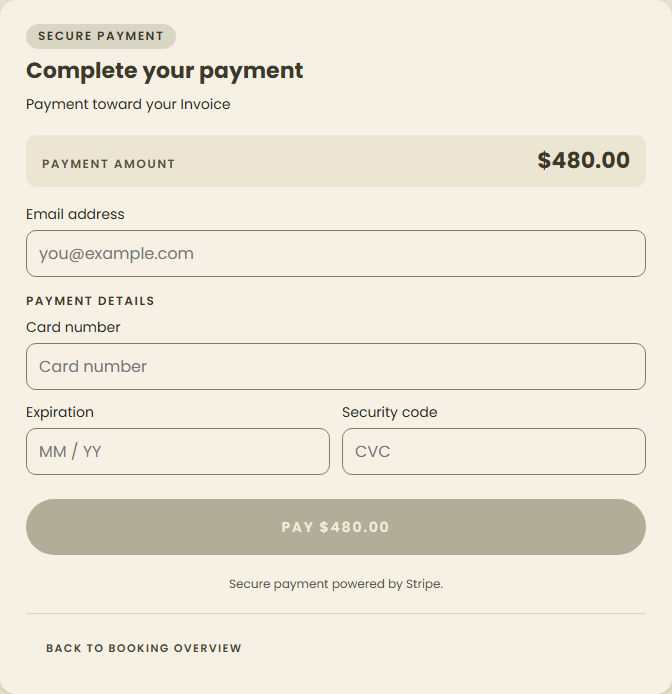

# Customer booking & payments

Customers pay Quote deposits and Invoice balances through Stripe Checkout from one stable,
inquiry-scoped page, `/pay/{publicId}` on the public site. Commerce picks a mode when it
authorizes each attempt. **Hosted** sends the tab to Stripe. **Embedded** mounts Stripe's full
form on the page. **Elements** puts Stripe's secure fields into Fiona's own payment panel.
Staff issue and manage the link from the request workspace. The backend contract is
fionas-commerce's executable OpenAPI and `docs/stripe-payments-frontend-handoff.md` (including PR #43).

**The frontend presents and initiates payments; it never decides that money was received.**
Commerce owns access, terms, amounts, authorizations and reconciliation; the ledger owns money.

## Where code lives

| Concern                                          | File                                                                                           |
| ------------------------------------------------ | ---------------------------------------------------------------------------------------------- |
| Customer page                                    | `apps/public/src/routes/pay/[publicId=uuid]/`                                                  |
| Page state machine (refresh, checkout, recovery) | `apps/public/src/lib/payments/controller.ts`                                                   |
| Fail-closed view of the summary                  | `apps/public/src/lib/payments/view.ts`                                                         |
| Contract types and strict readers                | `apps/public/src/lib/payments/contract.ts`                                                     |
| Exact USD cents (BigInt)                         | `apps/public/src/lib/payments/money.ts`                                                        |
| Bearer capture, tab storage, error classes       | `apps/public/src/lib/payments/checkout.ts`                                                     |
| Stripe.js boundaries (load, mount, teardown)     | `apps/public/src/lib/payments/embedded.ts`, `elements.ts`                                      |
| On-page payment panels                           | `apps/public/src/lib/components/payments/embedded-checkout.svelte`, `elements-checkout.svelte` |
| Customer wording                                 | `apps/public/src/lib/payments/copy.ts`, `$lib/components/payments/`                            |
| Public payment BFF (the only commerce access)    | `apps/public/src/lib/server/payments/bff.server.ts`, `transport.server.ts`                     |
| BFF routes                                       | `apps/public/src/routes/api/payments/[publicId=uuid]/`                                         |
| Security headers                                 | `apps/public/src/hooks.server.ts`                                                              |
| Staff link and attempt client, form action       | `apps/admin/src/lib/server/customer-payments.ts`, `$lib/customer-payments.ts`                  |
| Staff Customer payments card                     | `apps/admin/src/lib/components/requests/customer-payments.svelte`                              |
| Staff diagnostics refresh endpoint               | `apps/admin/src/routes/(app)/requests/[inquiryId]/customer-payments/+server.ts`                |
| E2E stubs                                        | `apps/public/e2e/payments/stub-commerce.mjs`, `apps/admin/e2e/payment-access-stub.mjs`         |

## The stable URL and bearer lifecycle

```
https://www.fionasicecream.com/pay/b8251ea0-c07c-4aad-bceb-644ed075c0a1#<43-character bearer>
                                    └ nonsecret publicId (path) ┘        └ secret (fragment) ┘
```

The fragment never reaches any server (not ours, not a CDN, not a log), so the page's server render
contains no booking data at all; the load function is empty. On the browser:

1. Read `location.hash`. It must be exactly 43 base64url characters; anything else shows
   "This payment link looks incomplete" and is never sent.
2. Store the bearer in **this tab's sessionStorage**, keyed by publicId
   (`fionas.pay.{publicId}.token`). A newer fragment replaces an older one (a rotated link).
3. Remove the fragment immediately with `history.replaceState` (SvelteKit's history state is kept;
   its `page.url` is synced right after hydration). Any `?checkout=` return marker goes too.
4. Read the summary through the same-origin BFF.

With no fragment, the page uses the bearer saved in this tab (this is how a Stripe return works).
With neither, it shows **Payment link required** and asks the customer to reopen the original link.
A 404 (unknown, rotated or revoked bearer; commerce answers all three identically) forgets the
bearer and shows "This payment link is no longer active". There is no lookup by email or name and
no credential recovery endpoint.

The bearer is never put in localStorage, cookies, query strings, server data, analytics, logs or a
global store: it lives in the page controller's closure and this tab's sessionStorage. If
sessionStorage is blocked the page still works while it stays open, and says so. A copied link
works in a new tab because it carries the fragment; a Stripe return relies on the original tab.

Opening a different link in the same tab (only the fragment changes) reloads the page from it.

## Same-origin BFF

The browser only calls the public site's own origin, with `credentials: 'omit'`:

| Browser call                                      | Forwarded to commerce                                                                  |
| ------------------------------------------------- | -------------------------------------------------------------------------------------- |
| `GET /api/payments/{publicId}`                    | `GET /public/payments/{publicId}` (`readCustomerPaymentSummary`)                       |
| `POST /api/payments/{publicId}/checkout-sessions` | `POST /public/payments/{publicId}/checkout-sessions` (`createCustomerCheckoutSession`) |

Exactly two narrow endpoints, not a proxy. Before any commerce call the BFF validates the UUID,
exactly one 43-character `X-Fionas-Payment-Token`, and (POST) a same-origin `Origin`,
`Sec-Fetch-Site` when present, `application/json`, an `Idempotency-Key` of 1–128
`[A-Za-z0-9_-]`, a body of at most 1 KiB, and a command of exactly `expectedDocumentVersion`,
`expectedBusinessRevision`, optional integer `amountMinor` (50–99,999,999), and optional opaque
`restartToken`. Anything else
(currency, totals, purpose, terms, proposal ids) is refused. The command is re-serialized
canonically.

Commerce receives only `Accept`, the bearer, and for checkout `Content-Type` and
`Idempotency-Key`: never site cookies, a staff session, a SERVICE token or any other browser
header. Redirects are not followed. Responses are re-built from the documented customer-safe
fields (unknown fields are dropped) and validated; error bodies keep only the stable `code` plus a
known conflict message (`PAYMENT_TERMS_CHANGED`, `CHECKOUT_KEY_REUSED`, `RECONCILIATION_PENDING`).
Backend message text never reaches the customer.

| Commerce outcome                       | BFF answer                 | Customer meaning            |
| -------------------------------------- | -------------------------- | --------------------------- |
| 200 valid                              | 200 (whitelisted)          | render / redirect           |
| 200 malformed                          | 502 `invalid_response`     | unknown outcome             |
| 400 / 404 / 409 / 422                  | same status, stable code   | per the table below         |
| 503 `stripe_disabled`                  | 503 `stripe_disabled`      | online payments unavailable |
| `COMMERCE_API_URL` unset or invalid    | 503 `payments_unavailable` | online payments unavailable |
| other 5xx, redirect, unexpected status | 502 `internal_failure`     | unknown outcome (same key)  |
| timeout / connection failure           | 504 `unavailable`          | unknown outcome (same key)  |

`transport.server.ts` is the only reader of `COMMERCE_API_URL` and logs only an operation name, a
status and a failure kind: never the URL, bearer, key, body or publicId. When commerce answers
200 but the body fails validation, `bff.server.ts` logs `Commerce payments answered with an
unreadable body` with the operation and the fixed name of the failed check (`ui_mode`,
`client_secret`, `credentials`, `summary`, …); an unexpected non-5xx status is logged as
`answered with an unexpected status`. Neither ever includes a value from the body. It never imports NATS or
inquiry submission code (`server-boundary.test.ts` enforces both).

**Headers.** Every `/pay/*` response (including `__data.json` and error pages) and every
`/api/payments/*` response sends `Cache-Control: no-store`, `Referrer-Policy: no-referrer`,
`X-Robots-Tag: noindex, nofollow`, `X-Content-Type-Options: nosniff` and

```
Content-Security-Policy: frame-ancestors 'none'; frame-src https://js.stripe.com https://*.js.stripe.com https://checkout.stripe.com https://hooks.stripe.com
```

(`PAYMENT_CSP` in `bff.server.ts`). `frame-ancestors 'none'` stops other sites framing this page;
it doesn't limit what the page frames. `frame-src` then allows only Stripe's documented frame
origins for Embedded Checkout and Elements, hosted Checkout, and 3D Secure / redirect
authentication. The site has no `script-src` or `connect-src` policy today, so Stripe.js (fetched
only from `https://js.stripe.com`) and its calls to Stripe aren't otherwise restricted. Anyone
adding one site-wide (or at the CDN/host) must allow at least `script-src https://js.stripe.com
https://*.js.stripe.com`, `connect-src https://api.stripe.com https://checkout.stripe.com` and
`img-src https://*.stripe.com` on `/pay`, plus SvelteKit's own inline bootstrap (nonce or hash).
Railway and the Cloudflare proxy add no CSP today. The page also has robots and referrer meta tags
and turns off SvelteKit link preloading. The only third-party script that may run here is official
Stripe.js, loaded only after commerce opens an on-page attempt. There is no analytics or service worker.

**No JavaScript.** Authorization arrives in the fragment, so the flow needs JavaScript. Without it
the page shows a branded explanation with the contact email; secrets never move to query strings.

## Page states

`paymentView(summary)` derives what the customer can do; anything unknown fails closed:

| Summary                                                            | View             | Action                                      |
| ------------------------------------------------------------------ | ---------------- | ------------------------------------------- |
| QUOTED, DEPOSIT, QUOTE, canPay                                     | `deposit-due`    | Pay the exact deposit (no amount input)     |
| BOOKED/SERVED, INVOICE, INVOICE, canPay                            | `balance-due`    | Pay the balance, or a different amount      |
| `paymentInProgress`                                                | `in-progress`    | Wait (polled); optional recovery or restart |
| `reconciliationPending`                                            | `reconciliation` | Contact staff; no collection                |
| `NO_PAYMENT_DUE`                                                   | `no-balance`     | Paid up, or a credit                        |
| `CLOSED`                                                           | `closed`         | Read-only history                           |
| `BELOW_STRIPE_MINIMUM` / deposit `ABOVE_STRIPE_MAXIMUM`            | `staff-assist`   | Contact staff                               |
| `NOT_PUBLISHED`                                                    | `not-ready`      | Wait for the quote                          |
| `UNSUPPORTED_CURRENCY`, unknown reason/lifecycle/mode, incoherence | `unavailable`    | Contact staff                               |

Page phases around it: initializing, link required, link incomplete, link unavailable, backend
unreachable (with Try again) and online payments unavailable. Busy states (`submitting`,
`redirecting`) disable the action. The document is labelled **Quote** or **Invoice** only:
customers never see generated version labels (no "Quote v4", "Invoice v8" or "Booked from Quote
v4"), in the overview, the payment copy or the Embedded Checkout description. `document.version`
and `businessRevision` stay internal and are still sent back exactly as `expectedDocumentVersion`
and `expectedBusinessRevision`; `acceptedQuoteRevision` is still validated but not shown. Hiding a
label never relaxes stale-term rejection. Figures come straight from the summary: total, payments
applied, remaining balance (or credit), the deposit while QUOTED, a whole-percent progress bar
after booking (presentation only), and receipts with refunded amounts. No line items, taxes,
service details, names, receipts or PDFs are invented.

**Privacy boundary.** A payment link is a bearer capability anyone holding it can open, including
from a forwarded financial email. The page shows only the event date, the document kind, totals,
payment progress and receipt amounts/dates. `readPaymentSummary` whitelists those fields, so the
page cannot render customer names, email addresses, phone numbers, postal addresses, staff notes,
conversation text, service descriptions or administration capabilities even if a response carried
them (covered by `contract.test.ts`). Bearer-only access, fragment handling, no-store, no-referrer
and noindex are unchanged.

**Exact money.** Decimal strings become BigInt cents (`decimalToCents`); a value that isn't whole
cents makes the summary invalid rather than rounded. Partial input accepts `250`, `250.5`,
`$1,250.00`, refuses more than two decimals, and must be at least $0.50, at most $999,999.99 and
at most the balance. A balance above the Stripe maximum disables the full option and requires a
partial; a balance below the minimum asks for staff help.

## Checkout idempotency

A deliberate Pay click freezes the reviewed `document.version`, `businessRevision` and amount,
generates one `crypto.randomUUID()` key, and **saves the key and exact body in sessionStorage
before sending** (`fionas.pay.{publicId}.checkout`). Double clicks are ignored in the controller
(not only by disabling the button), and while a saved command exists the ordinary Pay is hidden.

These results describe ordinary checkout. The restart-specific rules are in
[Customer-initiated checkout restart](#customer-initiated-checkout-restart).

| Result                                                           | Handling                                                                          |
| ---------------------------------------------------------------- | --------------------------------------------------------------------------------- |
| 200 OPEN HOSTED with a `https://checkout.stripe.com` URL         | mark the command redirected, navigate this tab (URL never stored)                 |
| 200 OPEN EMBEDDED with a client secret                           | mark the command redirected, mount Stripe's form here (secret in memory only)     |
| 200 OPEN ELEMENTS with a client secret                           | mark the command redirected, mount Fiona's panel with Stripe fields               |
| 200 OPEN HOSTED with a URL off the allowlist                     | refresh; the summary decides (OPEN → "earlier checkout still open")               |
| 200 unknown `uiMode`, both or neither credential (malformed)     | unknown outcome: keep the command, offer only **Try again** with the same key     |
| 200 EXPIRED / FAILED                                             | historical replay: forget the command, ask for a new deliberate payment           |
| network failure, timeout, 5xx                                    | retry the **same key and bytes** after 1.5 s and 4 s, then "Try again" (same key) |
| 409 `PAYMENT_TERMS_CHANGED`                                      | forget the key, refresh, "Your booking was updated"; next click is a new key      |
| 409 `CHECKOUT_KEY_REUSED`                                        | keep and block the command; only a deliberate **Start over** discards it          |
| 409 recovery codes (below)                                       | no key was claimed: forget it, refresh, explain; never an automatic retry         |
| 409 `RECONCILIATION_PENDING`, `checkout_reconciliation_required` | contact staff                                                                     |
| 422 / 400                                                        | forget the key, explain; the customer may try deliberately                        |
| 404                                                              | link no longer active                                                             |
| 503 `stripe_disabled`                                            | online payments unavailable                                                       |
| any other code                                                   | fail closed: refresh and require review                                           |

An ambiguous outcome survives a reload of the tab: the saved command stays `sending`, so the page
offers only **Try again** with the identical command. Payment is never re-authorized because a
request timed out.

## Freshness and uncertain outcomes

**Fresh summaries only.** `summaryFresh` separates a summary kept on screen for reading from one
that may back a new financial decision. It is true only after the latest read succeeded; a failed
refresh keeps the figures visible but disables Pay, fresh-key recovery, and restart behind **We couldn't
confirm your current balance, so paying is paused** with **Check again**. A summary older than five
minutes (`MAX_SUMMARY_AGE_MS`) is re-read when the customer clicks Pay: unchanged terms proceed in
the same click; changed terms (document version, business revision, purpose or amount) stop with
**Your booking was updated** for review; a failed re-read pauses paying. Resending this tab's own
saved command (Try again, resuming a cancelled Checkout) needs no fresh summary: the same key can
only reach its original authorization.

**Ordered reads.** Summary reads (start, manual refresh, polling, visibility, after a checkout
response, the pre-payment re-read) can overlap, so each takes a monotonically increasing
generation and only the latest may change anything: summary, freshness, notices, pending command
state, polling, loading, link revocation and the disabled state alike. A superseded read, whether
it succeeded, failed, got a 404 or `stripe_disabled`, is discarded untouched and reports
`superseded`. The pre-payment re-read follows superseding reads to the latest outcome, and proceeds
only when that read was accepted, nothing newer is pending and the terms still match; Pay is also
disabled while any read is in flight. Same-key resends never depend on these reads.

**Never a false guarantee.** `paymentUncertain` is true while this tab holds a saved command
(`sending` or `redirected`), after a Stripe return until a summary has resolved it, or when a
revoked link dropped one. Unavailability then reads **We can't confirm your payment status right
now. Please don't make another payment until we've checked it. Contact Fiona's if you need
assistance.**, for an unreachable backend, disabled payments and a failed refresh alike, and a
revoked link asks the customer to contact Fiona's before paying again. Without a possible payment,
disabled payments read "Online payments aren't available right now. Please try again later or
contact us for help." No message says a customer was or wasn't charged unless a summary shows it:
success wording needs the summary's effect, and a cancel redirect, an outage or a configuration
failure proves nothing. A `stripe_disabled` answer keeps a saved command unless it was brand new
and refused on its first attempt, because that refusal says nothing about an earlier send.

## Returning from Stripe

Commerce sends customers to `/pay/{publicId}?checkout=returned` or `?checkout=cancelled`. Neither
proves anything. The page restores the bearer, removes the marker and reads the summary:

- still `paymentInProgress` → **Confirming your payment** (returned) or **Checkout was cancelled**
  (cancelled; the Session may still be open) and polling;
- `QUOTED` → `BOOKED`/`SERVED`/`CLOSED` after a deposit → **Deposit received. Your booking is
  confirmed.** with the authoritative remaining balance;
- `paidAmount` increased after an Invoice payment → **Payment received. Your remaining balance is $X.**;
- otherwise → "Your last checkout wasn't completed".

A cancelled Checkout is never replaced just because the customer came back. Polling runs only
while a payment is underway and the page is visible, with bounded backoff (2, 3, 5, 8, 13, 20,
30, 30 s, then four 60 s reads, about six minutes), then offers **Check again**. There is no
public SSE.

## Checkout modes and on-page lifecycle

Stripe renders card fields, wallets and authentication in its own secure UI for all three modes.

Each checkout answer names its own immutable `uiMode`. The readers in `contract.ts` dispatch on
the mode stored on the attempt.

| OPEN answer                                                 | Read as                                        |
| ----------------------------------------------------------- | ---------------------------------------------- |
| `uiMode: HOSTED` + allowlisted `url`, no `clientSecret`     | navigate this tab (as before)                  |
| `uiMode: EMBEDDED` + `clientSecret` (any well-formed token) | mount Stripe's form on this page               |
| `uiMode: ELEMENTS` + `clientSecret` (any well-formed token) | mount Fiona's panel with Stripe Elements       |
| no `uiMode` + `url`, no `clientSecret` (pre-PR #38 release) | HOSTED, for the deploy overlap only            |
| unknown mode, both credentials, the wrong one, or neither   | refused (unknown outcome, same-key Try again)  |
| PROCESSING / SUCCEEDED / EXPIRED / FAILED                   | state and outcome kept; any credential dropped |

The BFF re-serializes the same reader's output, so the client secret
reaches the browser only in the answer to its own authorized checkout POST; summaries, page loads,
errors and logs never carry it.

**Starting.** A deliberate Pay click uses a fresh summary, reviewed terms, and one saved key and
body. An EMBEDDED or ELEMENTS answer replaces the action card on `/pay/{publicId}` with
**Complete your payment** and moves focus to its heading. Both load official Stripe.js from
`js.stripe.com` using the lazy `@stripe/stripe-js/pure` loader.

**Client-secret lifecycle.** The controller keeps the secret in its closure and exposes the launch
with mode, attempt identity, authorized cents, `isCurrent()` and `clientSecret()`. `clientSecret()`
resolves only while that launch is current and rejects once the form is closed, completed,
replaced, revoked or the page is disposed. It is never written to sessionStorage, localStorage,
cookies, URLs, history, server data,
logs or state that could be serialized. A secret needed again is obtained only by resending the
original key and exact body.

**Saved command.** The sessionStorage command keeps its `phase` literal `redirected` (meaning
"commerce opened a provider Session", whether or not the tab navigated) so commands survive a
deploy across compatible frontend releases. Elements saves the nonsecret commerce `attemptId`
and uses `completing` to lock a dispatched confirmation. `awaitingSettlement` distinguishes a
reported completion or provider processing from an unknown outcome. Older Elements commands
with only `completing` are treated as uncertain and bound to the original attempt by their key.

**One authorization.** While a form is open, ordinary Pay and recovery are blocked. Both panels
are keyed by launch. Embedded Checkout serializes initialization and teardown because Stripe
allows one Embedded Checkout per page. Elements destroys its mounted Stripe elements and detaches
its SDK change handler's receiver. Stripe's Elements SDK does not expose a general destroy or
unsubscribe method. Disposed launches cannot mount or act on late initialization or confirmation.

**Completion.** Embedded's `onComplete` and a reported Elements completion lead to the same commerce
summary read. The controller removes the form, marks the saved command `completing`, keeps
new payments closed, shows **Confirming your payment** / "We're confirming your payment", and
restarts the bounded summary polling. Only commerce's summary confirms: QUOTED → BOOKED shows
**Deposit received. Your booking is confirmed.** with the new Invoice and balance; a higher
`paidAmount` shows **Payment received. Your remaining balance is $X.** and a new deliberate Pay
for any further amount (a new key). A final payment shows **Your booking is paid in full.** with
no action; the booking never becomes CLOSED here.

**Closing the form.** **Back to booking overview** discards the secret and unmounts Stripe. It
does not cancel or expire the Session and proves nothing about money, so the page says **Your
payment is still open** and offers **Continue your payment**, which resends the same key and body
to reach the same Session.

**Reloads and returns.** A reload loses the secret by design. With the saved command still open
the page shows the same notice and **Continue your payment** (same key; nothing is sent on its
own). A Stripe authentication redirect returns to `?checkout=returned`. The page restores the
bearer, cleans the URL and reads the summary. A dispatched Elements confirmation stays locked
across reloads. The page shows **Confirming your payment** for reported completion and
**We couldn't confirm your payment status** for an indeterminate result.

**Failures.** A missing publishable key or a Stripe.js load or mount failure leaves the saved
command intact. Embedded offers **Try again** for load and mount failures. Elements offers
**Check previous payment** to reopen or check the original Session. Provider error text stays
out of Fiona's UI and logs.

**Mode switches.** Resuming an existing attempt uses its original presentation. Commerce's
configured mode only applies when authorizing a new Session.

**Changed terms.** A mounted form stays tied to the authorization that created it. Commerce keeps
reporting `paymentInProgress` while the original Session is open, even after staff amend the
booking, so "still underway" isn't enough. Every accepted (latest-generation) summary is compared
with the saved command by `authorizationMatches` (`controller.ts`):

| Saved command | Still valid only while the summary shows                                                             |
| ------------- | ---------------------------------------------------------------------------------------------------- |
| both          | the same `document.version` and `businessRevision`, USD                                              |
| DEPOSIT       | QUOTED, mode DEPOSIT, stage QUOTE, `requiredAmount` exactly the authorized cents                     |
| INVOICE       | BOOKED or SERVED, mode INVOICE, stage INVOICE, `balance` (applied money only) ≥ the authorized cents |

So an Invoice amendment, a deposit change, a manual payment that leaves less than the authorized
amount, a paid-in-full or CLOSED booking, or a DEPOSIT → INVOICE change all remove the form, even
while the attempt stays underway. A change commerce doesn't publish (such as an internal
deposit-requirement revision with the same amount) isn't visible here; commerce's own checks and
reconciliation remain the final safeguard, and a payment already submitted in that race is
reconciled there.

On a mismatch the controller drops the secret (its capability rejects, so a pending Stripe.js
initialization gets nothing and a late `onComplete` for that launch is ignored), the component
destroys the iframe, and the saved command, key, body, amount and revisions stay untouched. The
page shows **Your booking's payment details have changed** (derived again on every summary, so it
stays while the attempt is unresolved and survives reloads) and offers only **Check previous
payment**. That resends the original key and body so commerce can inspect the Session. If commerce
answers with the same OPEN Session, its secret is discarded unmounted. EXPIRED/FAILED,
`PAYMENT_TERMS_CHANGED`, recovery and reconciliation answers follow the usual rules. A new payment
is possible only after the old attempt is resolved, as a fresh reviewed decision with a new key.

| Situation                                         | Page shows                                                      |
| ------------------------------------------------- | --------------------------------------------------------------- |
| Customer closed the form, terms unchanged         | Your payment is still open → **Continue your payment**          |
| Accepted summary shows changed terms              | payment details have changed → **Check previous payment**       |
| Stripe reports completion before commerce settles | Confirming your payment                                         |
| Elements confirmation is indeterminate            | Payment status uncertain → **Check previous payment**           |
| No answer to the checkout request                 | the existing unknown-outcome wording → **Try again** (same key) |

If a summary shows the attempt no longer underway (settled, expired, reconciliation) the form is
removed and the authoritative state shown; a revoked link or disabled payments remove it too. It is
never replaced automatically. A failed summary read leaves the form visible and disables the
Elements Pay button until a fresh summary arrives. Superseded reads cannot invalidate a form.

## Elements payment panel



[Mobile panel with mock fields](images/checkout-elements-mobile.png)

Mock wallet layouts on [desktop](images/checkout-wallets-desktop.png) and
[mobile](images/checkout-wallets-mobile.png).

- **Stripe API.** `initCheckoutElementsSdk` uses the authorized Checkout Session secret.
  `loadActions` provides `getSession`, `validateElements` and `confirm`. The panel mounts a
  Contact Details Element, a Payment Element and one Express Checkout Element on that same SDK
  and Session. Both paths use the same saved checkout authorization, including its key, exact
  USD amount and Quote or Invoice revision. Stripe owns the wallet UI and its authentication.
  [Stripe's Checkout Elements integration](https://docs.stripe.com/payments/accept-a-payment?payment-ui=elements&api-integration=checkout)
- **Appearance.** The panel uses the shared Fiona's Card, Badge and Button. The Elements
  Appearance API takes resolved cream, olive, text and error colors, input radius and spacing
  from the site. `elementsOptions.fonts` supplies the existing Latin Poppins WOFF2 as a
  `CustomFontSource` so the iframe can load the font without another network origin.
  Stripe draws the provider-branded 48 px wallet buttons and arranges them for the available
  width. The panel shows the wallet area and card separator only while Stripe reports Apple Pay
  or Google Pay as available. It uses Stripe's default eligibility and keeps the card form
  available if neither wallet is eligible or Express Checkout fails to initialize.
  [Stripe Appearance API](https://docs.stripe.com/elements/appearance-api)
- **Amount.** Read `total.total.minorUnitsAmount`, `currency` and `minorUnitsAmountDivisor`
  from Stripe's Session. A positive safe integer in USD with divisor 100 must equal the
  exact cents pinned in the saved command. The panel displays that verified total, including
  the selected amount for partial payments. Missing or changed amounts close the fields
  and leave only same-attempt recovery.
- **Confirmation.** Card Pay requires both Stripe fields to be ready and `canConfirm` true,
  and validates the fields. Wallets use Stripe's `confirm` event as the payment input. Both
  paths verify the open Session and exact USD total, read a fresh commerce summary, then
  reverify the Session before dispatch. The controller checks `authorizationMatches` and saves
  the in-flight marker. A shared lock allows one dispatch through
  `actions.confirm({ redirect: 'if_required' })`. Wallet confirmation also passes Stripe's
  original `expressCheckoutConfirmEvent`. Stripe uses commerce's configured return URL.
  The installed Stripe.js types distinguish
  success, `paymentFailed` and an unclassified error with a null code. An explicit `paymentFailed`
  on an open Session clears the local lock and keeps the same fields mounted for correction.
  A reported completion removes the form and waits for commerce's ledger. Null or unfamiliar
  codes and thrown confirmation errors remove the form, keep the lock and show the uncertainty
  notice. Both paths refresh and poll the authoritative summary with the existing bounds.
  [Stripe Checkout confirmation](https://docs.stripe.com/js/custom_checkout/confirm)
- **Email and cancellation.** Stripe handles wallet contact collection through the Checkout
  Session and the original event. A wallet-provided billing email can satisfy the requirement
  with the card fields empty. If the wallet supplies no email, the customer can use the
  Stripe-owned Contact Details field. With neither source present, the app ends the wallet
  interaction using Stripe's validation callback and asks the customer to provide an email.
  Payer email stays in Stripe's payment flow. Dismissing the sheet before authorization leaves
  the Session open. Stripe can also emit `cancel` after `confirm`, so dismissal never clears
  an in-flight lock or substitutes for the confirmation result.
  [Stripe Express Checkout with Checkout Sessions](https://docs.stripe.com/elements/express-checkout-element/accept-a-payment?payment-ui=embedded-components)

### Wallet eligibility and configuration

Serve the page over HTTPS, including real-device development and preview testing. Register each
exact hostname that serves `/pay` in [Payment method domains](https://dashboard.stripe.com/settings/payment_method_domains).
Include the production hostname in live mode and register staging and HTTPS development hosts
in the Stripe sandbox used for testing. Use a registered HTTPS test hostname or tunnel for a
local build. Check Apple Pay and Google Pay in the corresponding account's
[Payment methods settings](https://dashboard.stripe.com/settings/payment_methods) and match
the public publishable key to commerce's account and mode. The existing `card` payment method
on the Checkout Session supports both wallets.

Stripe also checks browser, device, region, currency and wallet setup. An enabled Dashboard
setting alone does not guarantee a button. This integration uses Stripe's default eligibility
for both wallets. Stripe's supported-browser table also describes opt-in modes that expand
availability on some desktop browsers. Use a top-level browser tab for real-device tests.
The existing payment CSP permits Stripe's frames and denies embedding Fiona's payment page.
[Stripe browser support](https://docs.stripe.com/elements/express-checkout-element#supported-browsers) ·
[Stripe domain registration](https://docs.stripe.com/payments/payment-methods/pmd-registration)

### Checking an uncertain Elements confirmation

**Check previous payment** sends one deliberate request with the exact original key and body.
Commerce retrieves the Stripe Session attached to that key, verifies its identity and
authorization, and reconciles it. Stripe documents an open Session as one where payment
processing has yet to start. Only a validated `OPEN` / `PENDING` Elements response for the
original attempt and a fresh, matching commerce summary allow the controller to clear
`completing` and mount that same Session. The form verifies Stripe's status and exact USD total
again. The customer submits again deliberately using an eligible wallet or valid card fields.
[Stripe Checkout Session status](https://docs.stripe.com/api/checkout/sessions/object#checkout_session_object-status)

- `PROCESSING`, `SUCCEEDED` and a previously reported completion keep the form closed. The
  commerce summary supplies any booking transition or applied balance. The customer can check
  the same attempt again while settlement remains unresolved.
- `EXPIRED` or `FAILED` for the original attempt releases the lock. A fresh summary and a new
  customer decision are required before any replacement authorization.
- Timeouts, malformed responses and changed terms preserve the key and keep confirmation locked.
  The status view offers a new deliberate check or contact help. Revoked links follow the
  existing access rules.
- The public summary describes the booking and active collection in aggregate. Without applied
  money or a terminal answer for the original key, an empty active-payment state alone leaves
  confirmation locked. Recovery needs no new provider-status field or endpoint.

## Recovery and reconciliation

While a payment is underway the ordinary Pay is disabled. When the summary's optional
`checkoutRecoveryAvailable` is true (absent means false), or this tab still holds its own
redirected command, the page offers a separate **Check previous payment and continue**:

- with this tab's original key and body: resend them, which returns the original authorization
  (back to the same open Checkout) or a historical result;
- without them (another browser, lost storage): one deliberate command with a fresh key and the
  currently reviewed versions (and, for an Invoice, the chosen amount). Commerce checks the old
  Session first and authorizes a replacement only after confirmed expiry/failure.

| Recovery code                      | Customer sees                                                   |
| ---------------------------------- | --------------------------------------------------------------- |
| `checkout_in_progress`             | An earlier checkout is still open. Review the available options |
| `payment_processing`               | A payment is being confirmed; don't start another               |
| `payment_state_changed`            | An earlier payment was recorded; review the new balance         |
| `checkout_recovery_conflict`       | Status just changed; review and retry deliberately              |
| `checkout_reconciliation_required` | Checkout status is uncertain. Contact staff if unresolved       |

An ordinary recovery conflict never starts a fresh-key loop. `reconciliationPending` shows "We received a
payment that needs staff review. Please contact Fiona's before paying again." and offers no payment
until commerce clears it. BOOKED is shown only when commerce says BOOKED.

### Customer-initiated checkout restart

An authorized summary can include `checkoutRestartToken` when an OPEN or CREATING attempt is
the only blocker to collection. With that hint, the booking overview offers **Restart checkout**
alongside the available continue or status-check action. The old browser key is optional, so a
customer can reopen the original link in another tab. The review shows the approved Quote deposit
in full or the current Invoice balance and the existing exact-cent amount chooser. A balance above
Stripe's per-payment maximum requires a partial amount.

Opening the review is read-only. The final button submits the reviewed versions, the selected
amount for an Invoice, and the opaque `restartToken` through the existing BFF with a fresh UUID key.
The five-minute summary policy still applies, and a changed target or terms require a new review.
Commerce verifies the targeted checkout with Stripe and only authorizes a replacement after
confirming the previous Session expired unpaid. Its answer may include `replacedAttemptId`.
An OPEN replacement uses its own Hosted, Embedded or Elements launch. Returning to the overview
unmounts the previous form and discards its in-memory credential before any replacement can mount.

A deliberate restart can supersede a saved open command after the new key and exact body have
been saved to sessionStorage. If storage fails, the earlier command stays intact and the page
does not send the restart. Unknown POST outcomes and unresolved local Stripe confirmations keep
their earlier recovery lock. **Try again** reuses the committed key and exact body, including
the original restart token and amount. The token is retained only as part of that tab's saved
command and is excluded from URLs, logs and analytics. Stripe credentials stay out of storage.
An ambiguous response or provider reconciliation conflict gets bounded exact-key retries.
An unresolved reconciliation conflict or key reuse requires staff help and preserves the command.

Processing payments remain pending. A capture, stale terms or competing attempt triggers a
summary read and requires a new decision under the current eligibility. Historical EXPIRED or
FAILED replays also return to review. If a fresh summary has no restart token, the page falls
back to its existing status and recovery controls.

## Staff link management

The request workspace's **Customer payments** card sits directly under **Right now** (both in the
rail on wide layouts; before Activity when stacked). It renders only for QUOTED, BOOKED, SERVED
and CLOSED and only when the staff member has **all three** of `fionas.payment-access.manage`,
`fionas.inquiries.read` and `commerce.financial-document.read`; otherwise no backend call is made
and every other workspace capability is unchanged. The first permission is granted to no role,
Administrators included: an administrator must grant it explicitly through runtime role
administration. The console never expands grants or substitutes a SERVICE credential.

| Staff action                  | Commerce call                                                       |
| ----------------------------- | ------------------------------------------------------------------- |
| workspace load (status only)  | `GET /staff/requests/{id}/payment-access`, `GET …/payment-attempts` |
| Create / issue a new link     | `POST /staff/requests/{id}/payment-access`                          |
| Copy payment link             | `GET /staff/requests/{id}/payment-access` (deliberate, read-only)   |
| Rotate link (confirmed)       | `POST /staff/requests/{id}/payment-access/rotate`                   |
| Revoke link (confirmed)       | `POST /staff/requests/{id}/payment-access/revoke`                   |
| Check with Stripe (confirmed) | `POST /staff/requests/{id}/payment-attempts/{attemptId}/reconcile`  |
| Release previous checkout     | the same reconcile POST, for a superseded OPEN attempt (below)      |

All go through `backend.ts` with the staff member's own cookie and trusted `Origin`; POSTs have no
body and are sent once (never retried; an uncertain result says **Reload to review** and blocks
the card). The workspace load exposes only `none` / `active` / `revoked` and the nonsecret
publicId: the usable URL is read only when staff click **Copy payment link**, returned only in that
action's response, validated to be exactly `…/pay/{publicId}#<43 chars>`, and written to the
clipboard (`ClipboardItem` inside the click's activation, then `writeText`). If the clipboard is
unavailable, a selectable read-only field shows it until hidden or for two minutes. Copying never
rotates or recreates the link; the same link survives Quote revisions and Invoice amendments.

Rotation and revocation each sit behind a disclosure that explains the consequence (every copy
stops working; payments already underway can still be reconciled) before the confirming button.
CLOSED bookings can copy and revoke an existing link but cannot create or rotate one. REQUESTED and
DECLINED never show the card. Stripe disabled reads "Online payments are turned off in commerce";
manual payments still work.

With JavaScript, actions are enhanced forms whose results stay inside the card: no workspace
invalidation, so reply drafts, editor drafts and disclosures are untouched. Without JavaScript the
same `?/customerPayments` action re-renders the page.

**Attempt diagnostics** (a disclosure) list purpose, authorized amount, creation time (Pacific),
the reviewed Quote/Invoice revision, provider state, reconciliation outcome, whether a ledger
payment exists and the static diagnostic code. `RECONCILIATION_REQUIRED` is highlighted in rust
with "Money reached the ledger but was not allocated automatically" and a card-level warning; it is
never presented as applied. **Check with Stripe…** (button: **Check payment status**) appears for
active or paid-but-pending attempts, explains that it never creates a charge or allocates unapplied
money, and refreshes the list. Any provider URL in the reconcile response is dropped. Attempts are
diagnostics, not ledger facts: Activity remains the payment history, and nothing here repeats it.
No refund or dispute controls.

### Previous checkouts after a revision

fionas-commerce PR #41 decoupled financial emails from checkout: staff can email a revised Quote
or Invoice while the customer's earlier Checkout Session is still OPEN, CREATING, PROCESSING or
unresolved (see [Quote and Invoice emails](admin-financial-emails.md#checkout-independence)). The
earlier session keeps collection reserved until commerce releases it. The card makes that
visible without opening the diagnostics, and the email workflow never waits for it.

`$lib/checkout-attempts.ts` is a pure **presentation** classifier. It compares each attempt with
the current terms read from the authoritative staff request only:

| Current document                    | Compared with the attempt's `purpose`, `documentVersion`, `businessRevision`, `authorizedMinor` |
| ----------------------------------- | ----------------------------------------------------------------------------------------------- |
| Quote (`financial.stage` QUOTE)     | `DEPOSIT`, `financial.version`, `currentQuoteRevision`, exactly the active `requiredAmount`     |
| Invoice (`financial.stage` INVOICE) | `INVOICE`, `financial.version`, `currentInvoiceRevision`, at most `reconciliation.balance`      |

Amounts compare as exact integers (no floats, no rounding). Statuses: `open_current` (every
comparable field matches), `open_superseded` (some exposed field demonstrably differs: a deposit
checkout after booking, an earlier ledger version or business revision, a different deposit
amount, more than the balance), `open_unverified` (the comparison isn't possible: no business
revision, no active deposit, an unknown purpose), `creating`, `processing`, `paid_pending`
(SUCCEEDED, not yet applied), `applied`, `reconciliation_required` (outranks every state),
`expired`, `failed` and `unrecognized`.

**State/outcome contract.** A response can be well-formed (enum-shaped strings) yet describe a pair
commerce never produces. `supportedAttemptState` accepts exactly the pairs `CustomerPayments`
writes: commerce sets `APPLIED` or `RECONCILIATION_REQUIRED` only together with `SUCCEEDED` and a
ledger payment, and leaves every other state `PENDING`.

| State         | Outcome                   | Reading                                                |
| ------------- | ------------------------- | ------------------------------------------------------ |
| `OPEN`        | `PENDING`                 | open (current, superseded or unverified); not released |
| `CREATING`    | `PENDING`                 | unconfirmed                                            |
| `PROCESSING`  | `PENDING`                 | a payment is being confirmed                           |
| `EXPIRED`     | `PENDING`                 | provider-confirmed release                             |
| `FAILED`      | `PENDING`                 | failed                                                 |
| `SUCCEEDED`   | `PENDING`                 | paid at Stripe, application not confirmed (\*)         |
| `SUCCEEDED`   | `APPLIED`                 | applied to the booking                                 |
| `SUCCEEDED`   | `RECONCILIATION_REQUIRED` | captured; staff reconciliation required                |
| anything else |                           | `unrecognized`: fails closed                           |

(\*) Commerce doesn't write this pair today; it is accepted as the conservative reading (never a
success) that the earlier diagnostics already used. A listed attempt must also carry a
`ledgerPaymentId` exactly when its outcome is `APPLIED` or `RECONCILIATION_REQUIRED`
(`coherentAttempt`). The same validation drives the reconcile feedback and the attempt list: an
unsupported answer is unconfirmed (**Reload to review**, card blocked), and an incoherent listed
attempt shows **Checkout status needs investigation** with only **Reload to review** (no Stripe
check, no release), a rust **Status unclear** badge and "Outcome not confirmed" in place of its
outcome label. It never reads as paid, applied or released, and never counts toward the
reconciliation warning.

The main card area shows only attempts that need a decision, newest first:

| Status                            | Card                                                                  | Action                             |
| --------------------------------- | --------------------------------------------------------------------- | ---------------------------------- |
| `open_superseded`                 | **Previous checkout is still open**                                   | **Release previous checkout**      |
| `processing`, `paid_pending`      | **A payment is being confirmed** (rust)                               | **Check payment status**           |
| `creating`, `open_unverified`     | **Checkout status isn't confirmed**                                   | **Check payment status**           |
| `unrecognized`                    | **Checkout status needs investigation** (rust)                        | **Reload to review** only          |
| `reconciliation_required`         | the existing card-level warning                                       | none (unapplied-payment review)    |
| `open_current`, settled, released | nothing (diagnostics only; the row says "Matches the current terms.") | the row's **Check payment status** |

Every action is the existing `POST …/payment-attempts/{attemptId}/reconcile` form (`intent=reconcile`
plus `attemptId`); there is no new payload, route or cancellation API. Commerce retrieves or
recovers the session, compares its own complete `termsMatch` (proposal and deposit revision
included, which the attempt DTO does not expose), and asks Stripe to expire it only when open with
obsolete terms or revoked access. So **Release previous checkout** is never offered for a current
checkout, and a click never claims success: the button reads **Checking with Stripe…** while every
other card action is disabled, and the answer is reported by its validated state.

The action accepts the answer only for the submitted `attemptId`, re-lists the attempts from
commerce, and words the result by `reconcileFeedback`:

| Answer                               | Staff message                                                                                   |
| ------------------------------------ | ----------------------------------------------------------------------------------------------- |
| `EXPIRED`                            | released; the customer can start a new payment from the same link if the current terms allow it |
| `FAILED`                             | the attempt failed; review the current payment status                                           |
| `OPEN`                               | still open, so it wasn't released (commerce found its terms current)                            |
| `CREATING`                           | not confirmed yet; check again shortly                                                          |
| `PROCESSING`                         | a payment is being confirmed; don't start or record another                                     |
| `SUCCEEDED` + `PENDING`              | paid at Stripe, not applied yet                                                                 |
| `SUCCEEDED` + `APPLIED`              | payment applied; Right now shows the updated balance                                            |
| `RECONCILIATION_REQUIRED`            | received but needs staff reconciliation; don't collect it again                                 |
| other attempt, unsupported pair, 5xx | couldn't confirm what Stripe did; **Reload to review** blocks the card                          |
| 409                                  | couldn't reconcile, no release was confirmed; **Reload to review** blocks the card              |

A reconcile 409 proves only that no confirmed outcome reached this caller: Stripe may still have
changed the session or captured money. So it never says nothing settled, nothing was cancelled or
a new checkout is safe; it locks the card behind **Reload to review** like an ambiguous answer, and
its static code is logged server-side only (`[customer-payments] {id} reconcile 409 {code}`).
Payment-link 409s (issue, rotate, revoke) stay definite and unchanged.

Only EXPIRED and FAILED are released; EXPIRED never promises that the booking is payable (other
restrictions may apply, and the public page enforces them). Nothing is retried, no replacement
checkout is created, and money captured against obsolete terms is never called cancelled, lost or
refundable. When an enhanced answer says money reached Stripe or the ledger (any `SUCCEEDED`
answer), the card calls `onsettlement`: the workspace runs one targeted Activity read and one
staff-request read so Right now reflects it in place (an open review panel keeps its snapshot and
says it is stale). An unconfirmed answer re-reads nothing automatically; it blocks the card until a
deliberate reload. EXPIRED, FAILED, OPEN, CREATING and PROCESSING answers
change no ledger fact, re-read neither, and so never invalidate an open email preview. No polling
is added. Without JavaScript the same form posts natively and the page re-renders with the result.

**The customer side is unchanged.** `/pay` needs no change for this: an old email's link is the
same stable URL and always shows the current authoritative Quote or Invoice. While the old session
stays reserved the page shows the payment underway (or **Check previous payment**) as before; a
PROCESSING or uncertain session keeps blocking collection. Once commerce reports the release, a new
payment is possible only as the customer's own fresh, reviewed decision with a new key, after a
current summary allows it. No customer names, contact details, activity or service details are
added to the page.

**Limitations.** The classifier can't see the proposal ID or deposit-requirement revision an
attempt was authorized under, the document ID, or commerce's collectibility rules. A change visible
only there reads `open_unverified` (or `open_current`), and the general status check lets commerce
decide. Conversely a `open_superseded` reading is a UI hint: if commerce disagrees it answers OPEN
and the card says so. Attempt reads are optional; without them none of this renders and payment
link management works as before.

**Live updates.** The existing timeline SSE is unchanged. After each authoritative Activity read
(`onrefreshed` on the Conversation card), Customer payments refreshes its attempts through
`GET /requests/{id}/customer-payments` (the admin's read-only endpoint; never a Stripe call) when
attempt data is on screen: the diagnostics disclosure is open, or a checkout notice or the
reconciliation warning is showing. Otherwise it marks them stale for when the disclosure opens. So
an old checkout that expires, starts processing or settles updates or removes its notice without
anyone expanding the diagnostics; a refresh never words an outcome itself (only a deliberate check
does).

Reads run through `$lib/attempt-refresh.ts`, the timeline's serialized `timelineRefresh` loop:
a burst of notifications coalesces, one arriving mid-read schedules another pass rather than being
dropped, and a read that started before a reconcile answer was applied is discarded and read again,
so older data never overwrites newer. A failed read (or one that returns no attempts) keeps the last
known attempts and says **We couldn't refresh the checkout status… Reload to review**; while it
stands, a superseded notice reads **Previous checkout may still be open** and offers only **Check
payment status**. The attempt list and the staff request also move at different moments: each read
records the staff-request snapshot it started against, and when a newer projection arrives (a
settled payment, a booking, a revision) the card refreshes its attempts. Until the two pair up again,
or after a failed read, **Release previous checkout** is replaced by **Check payment status**, so a
mismatched pair of snapshots never reads as proof that a checkout can be released. Provider-side
changes that send no SSE notification still need a manual check or reload; there is no polling.

When the Activity history changed, the workspace also re-reads the authoritative
staff request and refreshes Right now in place (an online deposit shows BOOKED, the Invoice and
the new balance without a reload); an open review panel keeps its snapshot and says it is stale.
See [Live staff financial state](admin-request-workspace.md#live-staff-financial-state). Nothing
invalidates the whole page.

## Configuration and deployment

| App    | Variable                        | Purpose                                                                                                                                        |
| ------ | ------------------------------- | ---------------------------------------------------------------------------------------------------------------------------------------------- |
| public | `COMMERCE_API_URL`              | Commerce origin for the payment BFF only (bare http(s) origin). Unset: payments unavailable                                                    |
| public | `ORIGIN`                        | adapter-node's public origin; must match the browser's, or checkout POSTs are refused (403)                                                    |
| public | `PUBLIC_STRIPE_PUBLISHABLE_KEY` | Stripe publishable key for Embedded and Elements (`pk_test_…` / `pk_live_…`), same account and mode as commerce. Runtime (restart, no rebuild) |
| admin  | `COMMERCE_API_URL`              | Unchanged; the staff link endpoints use it                                                                                                     |

The public app holds no Stripe secret or restricted key, webhook secret,
`FIONAS_PAYMENT_ACCESS_KEY`, staff credential or session; never configure them in fionas-web. The
publishable key is public by design. Stripe.js uses it only for an on-page Checkout.

**Rollout order.**

1. Deploy commerce with PR #43 and keep its current Checkout mode.
2. Deploy the frontend with all three modes and the existing publishable key. Verify a hosted
   payment and resume an existing Embedded attempt.
3. Set commerce's `FIONAS_STRIPE_CHECKOUT_MODE=elements` in Stripe test mode. Start a fresh
   authorization and complete the acceptance checklist below before enabling it in production.
4. To roll back the mode, set commerce to `embedded` or `hosted`. Keep the three-mode frontend
   and the publishable key available so existing Elements Sessions can recover.

`FIONAS_PUBLIC_BASE_URL` in commerce must match the exact public origin serving
`/pay/{publicId}` so issued links and Stripe return URLs point here.

**Local.** Run commerce on `http://localhost:8080` with `FIONAS_STRIPE_ENABLED=true`,
`FIONAS_STRIPE_LIVE_MODE=false`, a `sk_test_` key and `FIONAS_PUBLIC_BASE_URL=http://localhost:5173`
(test mode allows localhost). Set `COMMERCE_API_URL=http://localhost:8080` in `apps/public/.env`,
`npm run dev` and `npm run dev:admin`, grant your staff role `fionas.payment-access.manage`, then
issue and copy a link from a quoted request. The booking form (NATS) is independent: payments work
with `BOOKING_ENABLED=false` and no NATS.

**Staging / Railway.** On the public service add `COMMERCE_API_URL` pointing at commerce's private
network address (for example `http://fionas-commerce.railway.internal:8080`) or its HTTPS URL, and
keep `ORIGIN` at the public HTTPS origin. Set commerce's `FIONAS_PUBLIC_BASE_URL` to that origin
(for example `https://dev.fionasicecream.com`). Exclude `X-Fionas-Payment-Token`, URL fragments,
staff payment-access responses and Checkout URLs from any proxy/CDN/APM logging, and don't cache
`/pay/*` or `/api/payments/*` at the edge. Allow at least 40 s upstream timeouts on
`/api/payments/*/checkout-sessions` (commerce may contact Stripe and recover an earlier attempt).
If commerce is down or Stripe disabled, `/pay` says so and the marketing site and `/book` are
unaffected.

## Test-mode acceptance (manual)

Follow commerce's operations runbook for Stripe test mode and the webhook listener, then:

1. Grant a staff role `fionas.payment-access.manage`; confirm another account without it still
   sees the workspace and manual payments but no Customer payments card.
2. On a QUOTED request, **Create payment link**, then **Copy payment link**; copy again and confirm
   the same URL.
3. Open it in a fresh window: the fragment disappears, "Quote" (no version) and the exact deposit
   show.
4. Pay the deposit with test card `4242 4242 4242 4242`; on return the page shows confirming,
   then **Deposit received. Your booking is confirmed.**, Booked, "Invoice" and the balance.
5. Amend the Invoice in the console; reload the same link: the new Invoice revision and balance.
6. Pay a partial amount, then the rest; the page reports each applied payment and the balance.
7. Start a checkout and press Back on Stripe: **Checkout was cancelled**; **Check previous payment
   and continue** returns to the same Session.
8. Rotate the link: the old copy shows "no longer active"; the new copy works. Revoke: both fail.
9. Inspect **Online payment attempts** for the attempts above; use **Check with Stripe** on an open
   one.
10. Close the request after settlement: the link shows read-only history; the card offers only
    copy and revoke.

**Embedded mode** (after switching commerce to `FIONAS_STRIPE_CHECKOUT_MODE=embedded`, with
`PUBLIC_STRIPE_PUBLISHABLE_KEY` set to the same account's `pk_test_` key):

1. With DevTools open, load a quoted link: no request to `js.stripe.com` yet.
2. **Pay deposit**: the URL stays `/pay/{publicId}`, **Complete your payment** shows the deposit and
   Quote revision, and Stripe's form loads. The console shows no CSP violations; sessionStorage
   holds the command without any `cs_test_` value.
3. Pay with `4242 4242 4242 4242`: the form disappears, **Confirming your payment**, then (after the
   webhook) **Deposit received. Your booking is confirmed.**, Booked, the Invoice and balance.
4. Start a partial Invoice payment, choose **Back to booking overview**, then **Continue your
   payment**: the same Session (same amount) returns. In the console the attempt list shows one
   attempt. Finish it: **Payment received** with the remaining balance; pay the rest the same way.
5. Start a payment and reload: **Your payment is still open**; continuing reopens the same Session.
6. Use `4000 0027 6000 3184` (3D Secure): complete the challenge; the page confirms only from
   commerce. Fail it once to see Stripe's own error in the form.
7. Block `js.stripe.com` in DevTools and pay: the panel explains and **Try again** (after unblocking)
   opens the same payment; only one attempt exists.
8. With an embedded attempt open, switch commerce back to `hosted`: continuing still opens the
   embedded form; a fresh payment afterwards goes to Stripe-hosted Checkout.
9. With an embedded form open, amend the Quote or record a manual payment in the console, then
   wait for the next poll or **Check again**: the form is removed and the current state shown.
10. Repeat 2–3 on a phone: no horizontal scrolling; wallet buttons appear where Stripe offers them.

**Elements mode** (commerce `FIONAS_STRIPE_CHECKOUT_MODE=elements` with matching Stripe test keys):

1. Open a new Quote deposit attempt on desktop and mobile. Check that the page displays the
   exact reviewed USD amount. Verify Poppins loads in both Stripe frames and check focus,
   narrow-width layout, wallet eligibility on a supported browser and console CSP errors.
2. Leave email or card details invalid and verify Pay stays disabled. Use the Stripe test
   card `4242 4242 4242 4242` and a test email. Verify **Confirming your payment** until
   commerce records the deposit and moves the Quote to BOOKED with an Invoice.
3. Test a decline and a 3D Secure challenge with Stripe's test cards. Check that a decline
   leaves the same form available, authentication uses the configured return URL, and
   settlement still follows the commerce summary. [Stripe test cards](https://docs.stripe.com/testing#cards)
4. Pay part of an Invoice and check the ledger allocation and remaining balance. Pay the
   rest with a new reviewed payment and verify the zero balance and payment history.
5. Close and resume an open form, then reload and continue it again. Verify one attempt
   and an unchanged key and body. Block Stripe.js and verify recovery opens the same Session.
6. While a form is mounted, amend the Invoice or revise the deposit. Repeat with a manual
   payment that reduces the balance below the authorized amount. Verify the form goes away
   and **Check previous payment** keeps the original authorization. Repeat with revoked access.
7. Switch back to `embedded` or `hosted`. Resume an open Elements attempt and check that a
   subsequent new attempt uses the newly configured mode.
8. Verify the bearer is stripped from the address bar and that the Session secret, test email
   and payment details stay out of Fiona's storage, URLs, SSR output and logs.

**Express wallets on real devices** (same Elements mode and registered HTTPS test hostname)

1. On an iPhone, open the payment link directly in Safari with an active card in Apple Wallet.
   On an Android phone, open it directly in Chrome with an active card in Google Pay and the
   matching Google account signed in. Stripe test keys allow a real wallet card to return a test
   token without charging the card. [Stripe wallet testing](https://docs.stripe.com/elements/express-checkout-element/accept-a-payment?payment-ui=embedded-components#test-the-integration)
2. Start a fresh Quote deposit or Invoice payment on each device. Confirm Stripe shows the
   eligible button above the card form, the amount is correct, and the page fits the screen.
   Repeat in a browser without an eligible wallet and verify the card form works on its own.
3. Leave the card form blank. Open the wallet, dismiss it, and verify the same payment form
   remains usable. Open it again, authorize with a wallet email, and verify pending settlement
   until the commerce summary shows the applied payment. Check that there is one checkout
   attempt and one ledger payment. Where the wallet supplies no email, try the Contact Details
   fallback. Look for CSP errors in the device browser console.
4. On another test booking, change the reviewed terms or record a manual payment while the
   wallet sheet is open. Verify the stale form closes and **Check previous payment** uses the
   original authorization. If confirmation is interrupted, verify that the same action resumes
   only an original, verified open attempt or continues waiting for settlement.

## Tests

- Public unit: `money.test.ts`, `contract.test.ts` (summary/command/response readers and every
  view state), `controller.test.ts` (fragment capture, storage restore, missing/malformed/revoked
  links, exact deposit and Invoice bodies, duplicate clicks, same-key ambiguous retry and reload,
  terms changed, key reuse, unknown codes, Stripe returns, polling and visibility, recovery codes,
  expired replays), `bff.server.test.ts` (forwarded headers only, no cookies/SERVICE auth, token
  never in URLs, cross-origin/cross-site refusal, body and header validation, whitelisting,
  disabled/unreachable/misconfigured, no secrets in logs, the client secret only in the checkout
  answer, the CSP), `server-boundary.test.ts`. On-page modes: `contract.test.ts` (three modes,
  legacy hosted, invalid credentials, terminal states), `controller.test.ts`
  (in-memory secret, duplicate actions, close/continue and reload with the
  same key, mode switching, completion never success, delayed reconciliation, deposit and partial
  Invoice confirmation, removal on settled/revoked/disabled, unknown modes), `embedded.test.ts`
  (publishable keys, one instance at a time, late initialization destroyed, failures by kind) and
  `embedded-checkout.svelte.test.ts` (browser: mount once, focus, cleanup, retry, missing key).
  `elements.test.ts` covers appearance, mounts, wallet eligibility and email fallback, exact
  amount and currency checks, readiness, validation, the shared lock, safe errors and late SDK
  callbacks. The payment browser suite mocks Stripe wallet availability, cancellation, decline,
  settlement and uncertainty, competing card submission, and changed terms on desktop and mobile.
- Public E2E (`npm run test:e2e:payments --workspace=@fionas/public`; part of `test:e2e`; no
  Docker or NATS), desktop and mobile, against `e2e/payments/stub-commerce.mjs` with
  `checkout.stripe.com` simulated by routed pages: fragment capture and cleanup, security headers,
  storage restore after Stripe, missing/incomplete/rotated/revoked links, exact deposit, full and
  partial Invoice payments with precision/minimum/maximum/balance validation, an amendment on the
  same URL, changed terms, confirmation only from the summary, cancelled-but-open resume, pending
  polling, new-browser recovery without loops, same-key ambiguous retry, rapid clicks, staff
  review, CLOSED history, disabled/unreachable backend, unknown codes, cross-origin refusal,
  keyboard use, no horizontal scroll and the no-JavaScript fallback. `on-page-checkout.e2e.ts`
  routes `js.stripe.com` to a fake Stripe.js through the real loader. It checks that Stripe
  loads on demand, mounts on the payment page and keeps the client secret out of storage, URLs and HTML.
  completion → confirming → BOOKED, close and continue, reload, Stripe.js load failure and retry,
  mode switches and legacy hosted answers, delayed reconciliation, partial Invoice payments,
  keyboard focus and mobile width. Elements adds declined-card recovery and verifies Poppins
  loads in the mock fields. Set `PAYMENTS_SCREENSHOTS=<dir>` to save mock panel screenshots.
- Admin unit: `customer-payments.test.ts` (including reconcile answers for exactly the submitted
  attempt, one POST each, unsupported pairs, ambiguous refusals, a reconcile 409 locking for review
  while link conflicts stay definite), `checkout-attempts.test.ts` (exact amount comparison,
  current terms, every status, the state/outcome matrix and ledger coherence, release only for
  demonstrable supersession, feedback wording) and `attempt-refresh.test.ts` (coalesced bursts, a
  hint during a read, an older read never overwriting a local answer, failures, dispose). Admin E2E: `customer-payments.e2e.ts` (permission gating, stable copy,
  rotate/revoke, CLOSED and REQUESTED/DECLINED limits, no URL in HTML, clipboard fallback, attempt
  diagnostics and reconcile feedback, live refresh with the composer draft preserved, disabled and
  ambiguous outcomes) and `revised-checkout.e2e.ts` (Quote v3 emailed while Quote v2's checkout is
  open, then released; a matching checkout keeps only the status check; release keeps an open
  preview reviewable while a new Quote still invalidates it; 502/OPEN/409 never claim release
  (409 locks for review); live SSE updates with diagnostics closed (EXPIRED removes the notice
  with the preview and reply draft intact, PROCESSING then APPLIED, rapid notifications, a failed
  read kept unconfirmed); an incoherent OPEN+APPLIED attempt is investigated;
  PROCESSING, RECONCILIATION_REQUIRED and APPLIED answers; CREATING/PROCESSING get no release;
  keyboard, phone width and the no-JavaScript form). The stub's `reconcile` control sets the next
  answer (`{ result }` with an optional new `request`, or `{ status, code }`).

## Known limitations and future work

- The Checkout host allowlist is `checkout.stripe.com`; a Stripe custom Checkout domain would need
  adding to `checkoutRedirect`.
- Polling stops after about six minutes; the customer can **Check again**. There is no public push.
  On-page completion restarts the bounded polling.
- Automated checkout tests use mocked Stripe.js. Verify real Stripe iframe typography, wallets
  and authentication on the deployed HTTPS origin with the manual test-mode checklist.
- Stripe documents no `client_secret` format, so `isClientSecret` checks structure only: one
  non-empty token of visible ASCII, at most 4,096 characters, never an `sk_`/`rk_` API key. An
  earlier `cs_…[A-Za-z0-9_]` pattern refused real secrets in development (502, "We couldn't
  confirm your payment started"); don't reintroduce a format assumption.
- If sessionStorage is lost after leaving for Stripe, the customer must reopen the original link
  (by design; there is no credential recovery).
- No receipts, Invoice PDFs, payment-link emails, refunds, disputes or automatic reconciliation of
  unapplied money in this milestone. Staff resolve unapplied receipts through existing ledger tools.
- Staff copying needs a secure context (HTTPS or localhost) for the clipboard; elsewhere the
  fallback field is used.
